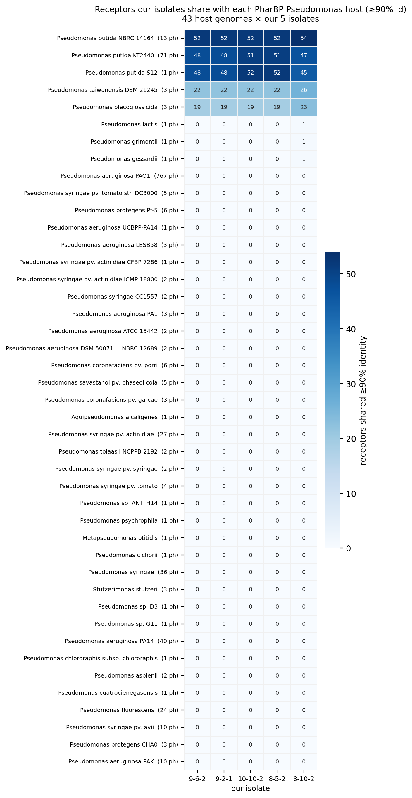
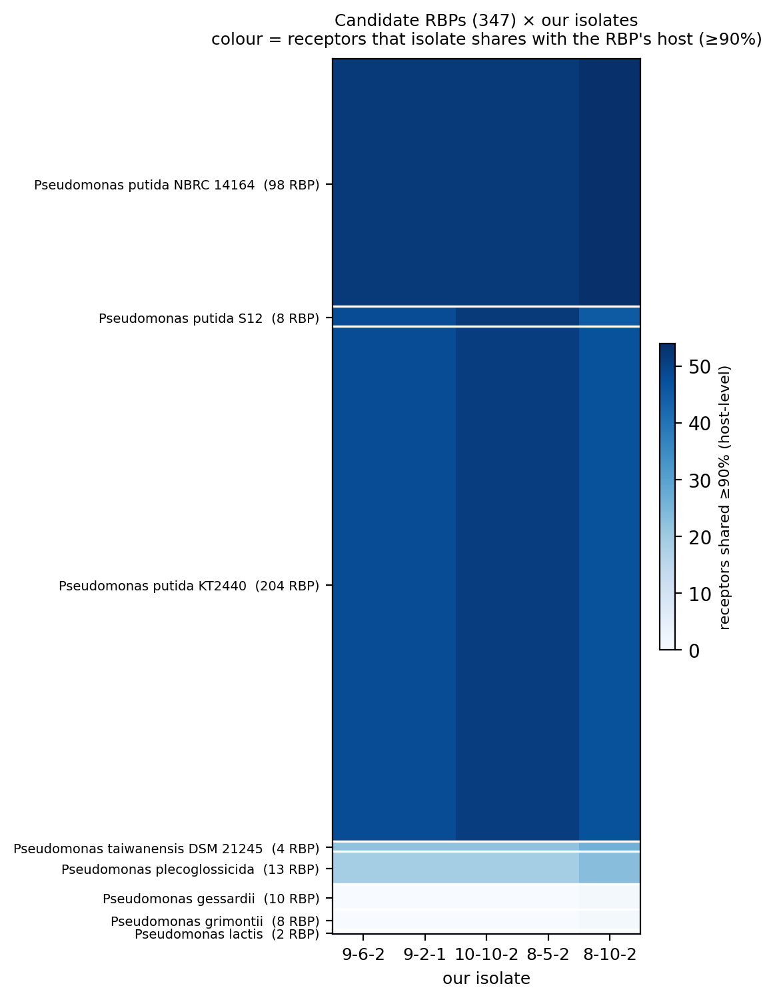
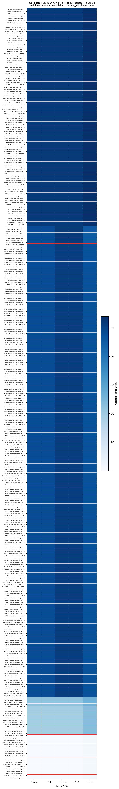
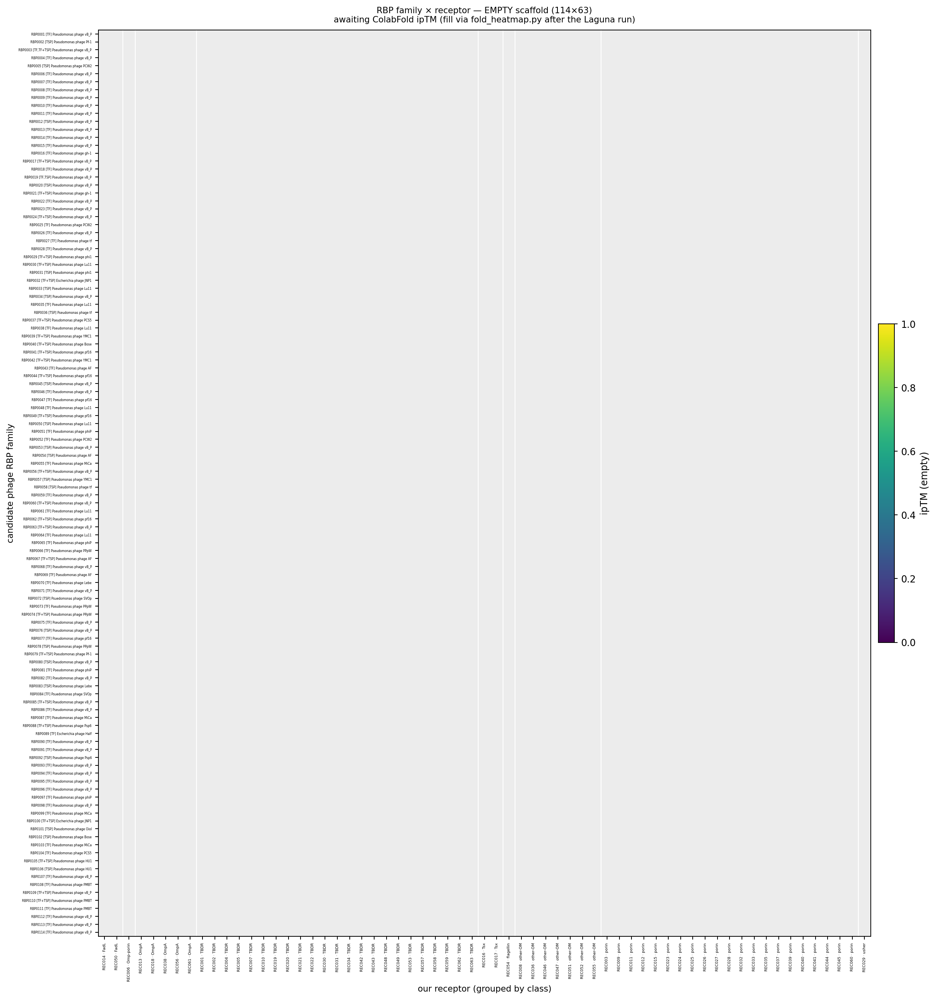
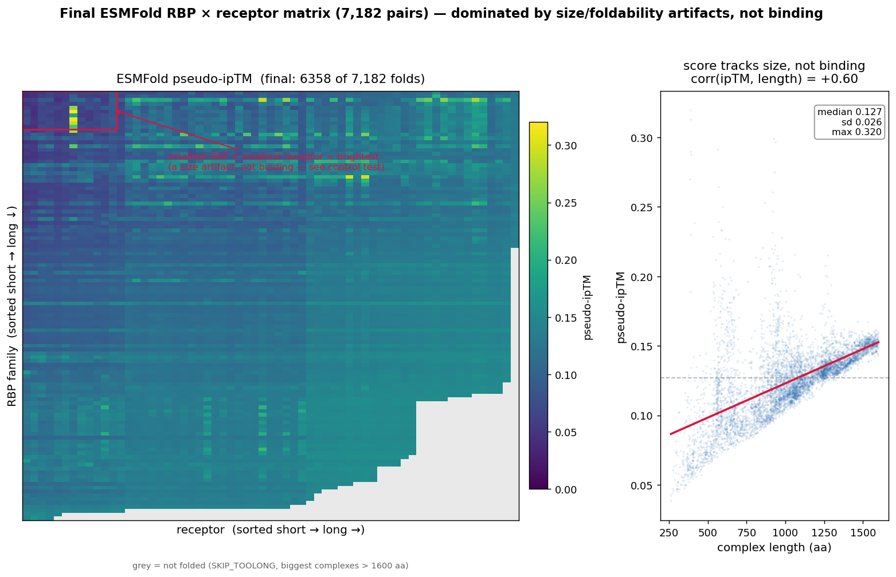
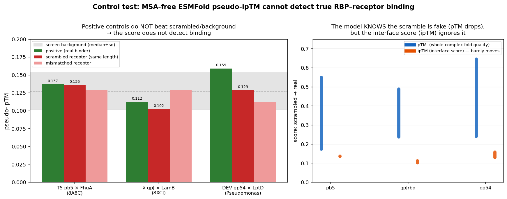

# Essential Evidence Map — phage receptor / host-range analysis

*A standalone walkthrough of the key files behind our phage–host analysis: what each one is, what it shows, and how they chain together. Images and table snippets are embedded inline. Files live under `code/output/0703_phage_host_matrix/`.*

## What we are doing

We are a phage-therapy project working with several **sequenced *Pseudomonas* isolates** (`9-6-2`, `9-2-1`, `10-10-2`, `8-5-2`, `8-10-2`). The goal is to figure out **which surface receptor our phages target** on these bacteria. Our own lytic phages are isolated (plaques) but **not yet sequenced**, so we can't read their receptor-binding proteins (RBPs) directly.

So we bridge indirectly: **(1)** catalogue each isolate's surface receptors, **(2)** ask which known *Pseudomonas* phages (from the **PharBP** database) infect strains that **share those receptors** — a clue for which phages / RBP classes could target our isolates. We then **(3)** tried to sharpen this with structural folding (RBP × receptor) — which turned out to be non-informative and is documented at the end as a controlled negative result.

---

# Part A — Our receptors and who shares them (the primary, clue-level evidence)

## 1. `receptor_by_strain.tsv` — our receptor catalogue

All isolates' receptors organized into **144 unique receptor groups**, marking how they overlap across the isolates. Groups present in **all 5 isolates (core) = 43**; groups present **only in 8-10-2 = 46**. This could be a key to a difference in host range.

| cluster_rep | category | n_strains | product |
|---|---|---|---|
| BPBBIK_01263 | FadL | 5 (core) | Long-chain fatty acid transporter |
| BPBBIK_00419 | LptD | 5 (core) | LPS-assembly protein LptD |
| BPBBIK_01078 | OmpA | 5 (core) | OmpA-like domain-containing protein |
| NEEDOG_02224 | FadL | 1 (8-10-2 only) | Long-chain fatty acid transport protein |

## 2. `pharbp_pseudomonas_hosts.tsv` — the PharBP host list

From **6,376 *Pseudomonas* host entries** on PharBP there are **43 unique genomes** (54 named strains; most of the rest are unspecified — just "Pseudomonas" — so unusable). This is the list of those bacteria.

| host | genome | # PharBP RBPs | # phages |
|---|---|---|---|
| *P. aeruginosa* PAO1 | GCF_000006765.1 | 3106 | 590 |
| *P. putida* KT2440 | GCF_000007565.2 | 227 | **71** |
| *P. aeruginosa* PA14 | GCF_030264075.1 | 130 | 40 |
| *P. syringae* | GCF_018394375.1 | 192 | 34 |

## 3. `receptor_host_presence.tsv` — our receptors × PharBP strains

A table combining files 1 and 2: how **our** receptors are present across the **54** PharBP strains (columns = # host strains matching at ≥90% / ≥70% / ≥50% identity, best host, etc.). This is the key intermediate step to indirectly predict the RBP range for our isolates.

| our_rep | category | hosts ≥90% id | max identity | best host |
|---|---|---|---|---|
| BPBBIK_01078 | OmpA | 6 | 97.7% | *Pseudomonas putida* |
| NEEDOG_04082 | other-OM | 7 | 98.7% | *Pseudomonas putida* |

## 4. `shared_receptors_heatmap.png` — visualization of file 3

Only the ***P. putida*** group and a few others share a large number of receptors with us. Row labels also mark the number of phages that infect each strain. ***P. putida* KT2440** is a very interesting strain from PharBP: a large range of shared receptors **and** many phages that infect it.

> **From all the analysis above, we know: the list of our receptors that appear in PharBP, and the hosts that share the same receptors.**

## 5. `rbp_by_strain_heatmap.png` & `rbp_by_strain_detailed.png` — the RBP-side view

The other angle on file 4. The first shows the reference strains from PharBP; the second shows the exact RBPs that bind a specific strain.

---

# Part B — The folding attempt (RBP × receptor) and why it's a negative result

Due to a large volume of candidates on both sides, we condensed both lists. For RBPs we kept a representative for highly similar ones (>90%). For receptors we kept only those a phage would actually bind (removed efflux pumps etc.).

## 6–7. `condensed_rbps.tsv` (114) & `condensed_receptors.tsv` (63)

The condensed lists: **114 RBPs** and **63 receptors**.

| rbp_id | type | # members | length | host |
|---|---|---|---|---|
| RBP0001 | TF | 25 | 682 | *P. putida* KT2440 |
| RBP0002 | TSP | 20 | 806 | *P. putida* KT2440 / NBRC 14164 |

| rec_id | category | our strains | product |
|---|---|---|---|
| REC014 | FadL | all 5 | Long-chain fatty acid transporter |
| REC006 | Omp-porin | all 5 | OmpW family protein |

## 8. `rbp_receptor_iptm_heatmap_EMPTY.png` — the blank scaffold

A blank heatmap before any simulation, just to show the size of the problem (114 × 63 = 7,182 pairs).

## 9. `binding_matrix.csv` — the full simulation results

All **7,182** pairs predicted by ESMFold (6,358 folded OK + 824 skipped for being too long).
- `iptm` = interaction/binding score · `ptm` = folding quality · `status` = whether the pair was skipped for length.

| rbp_id | rec_id | iptm | ptm | status |
|---|---|---|---|---|
| RBP0001 | REC001 | 0.145 | 0.524 | OK |
| RBP0001 | REC002 | 0.137 | 0.534 | OK |

However, there are large issues and bias, discussed next.

## 10. `rbp_receptor_iptm_heatmap.png` — the screen, visualized

The important message: **ipTM and complex length are correlated (r = +0.58)** — the score tracks protein size, not binding. This is not what we want.

## 11. `control_validation.png` — a control test for ESMFold

Our 7,182-pair folding matrix gave suspiciously flat scores (everything near 0.13), and the top "hits" tracked protein size rather than any specific pairing. A binding screen is only meaningful if it can tell a real binder from a non-binder — so before trusting or discarding the matrix, we tested the method against pairs with known answers.

**The hypothesis.**
- **H1 (method works):** if the pseudo-ipTM reflects real binding, documented binders should score **above** their scrambled/mismatched controls and above the screen background.
- **H0 (null):** the score reflects generic foldability/size, so real ≈ scrambled ≈ background.

**The three positives (and where they came from).** We chose experimentally documented phage RBP–receptor pairs from the literature, prioritizing ones with solved co-structures (ground truth) plus one in our own organism; sequences pulled from UniProt/NCBI:

| Positive pair | RBP accession | receptor accession | evidence |
|---|---|---|---|
| T5 **pb5** × *E. coli* **FhuA** | P23207 | P06971 | cryo-EM co-structure, PDB **8A8C** |
| λ **gpJ** (C-term RBD) × *E. coli* **LamB** | P03749 | P02943 | co-structure, PDB **8XCJ** |
| DEV **gp54** × *P. aeruginosa* **LptD** | ASZ72261.1 | Q9I5U2 | genetics + AlphaFold, mBio 2026 (our organism) |

For each, we also folded a **length-matched scrambled** receptor (same residues, shuffled — removes the size confound) and a **mismatched** receptor, through the identical pipeline.

| positive pair | real | scrambled | mismatch | background |
|---|---|---|---|---|
| T5 pb5 × FhuA (8A8C) | 0.137 | **0.136** | 0.129 | median 0.127 |
| λ gpJ × LamB (8XCJ) | 0.112 | 0.102 | 0.129 | (sd 0.026) |
| DEV gp54 × LptD | 0.159 | 0.129 | 0.112 | |

**Conclusion — H0 supported, H1 rejected.** Known binders did not separate from controls. The clincher: whole-complex **pTM collapses** when the receptor is scrambled (e.g. 0.55 → 0.17) — so the model *knows* it's fake — **but the interface ipTM does not move**, proving the interface score isn't reading a real interface. The folding screen is therefore **not informative** for RBP–receptor binding, and we do not use it as evidence. **Our receptor-repertoire overlap (Part A) remains the primary, clue-level readout, and does not depend on this step.**

---

*Method history: `2026-07-04_folding_tool_odyssey.md` (tool troubleshooting), `2026-07-04_folding_tool_recommendation.md` (tool choice), `2026-07-05_esmfold_matrix_note_for_PI_EN.md` (PI note), `2026-07-05_phage_host_matrix_reasoning_summary.md` (full reasoning). Log — 2026-07-05.*
