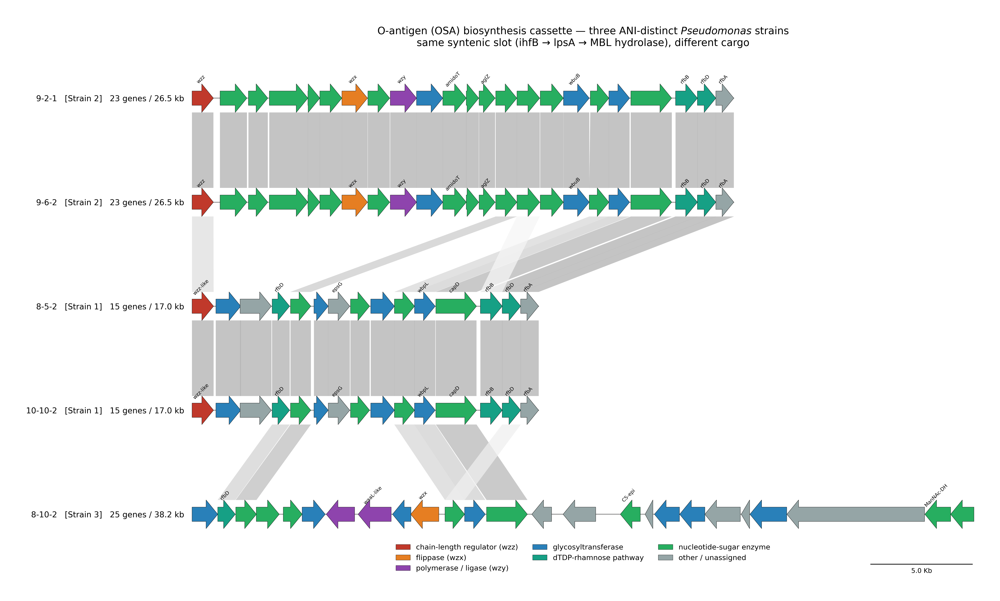
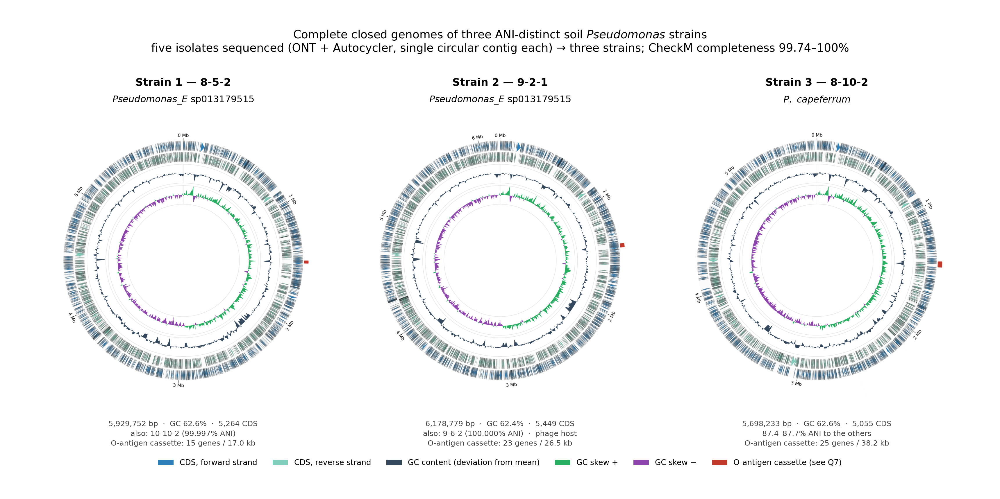
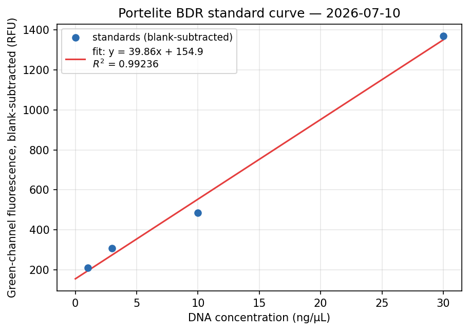
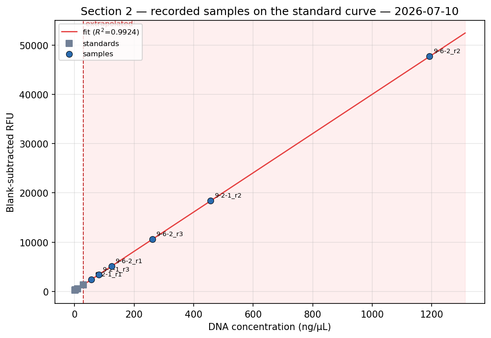

::: {.callout-note title="這份文件是什麼"}
教授在 2026-07-27 的信裡開了七項工作，其中一項標為 immediate。這份文件把「七題」與「我們手上所有的結果」接在一起，一次講完：

- **§1** 把七題攤開——原文、他真正要的是什麼、我們實際在看什麼、現在做到哪。
- **§2** 講清楚我們的材料——五個 isolate 其實是三個菌株，噬菌體只有一隻。後面所有數字都建立在這上面。
- **§3** 一張完整的結果總表——repo 內所有已產出的 results，含證據等級與可用場合（論文 / 簡報 / wiki）。
- **§4** 第 7 題的完整答案——O-antigen locus 比較，本週唯一新增的科學結果。
- **§5** 下一步，以及三件必須跟教授確認的事。
- **附錄** 圖與來源對照表。

§1–§3、§5 是**索引與現況**；§4 是**完整分析**。分析程式在 `code/0727_o_antigen_comparison/`。
:::

::: {.callout-tip title="重點速覽 —— 七題直接回答"}
先給答案，細節在 §1 與附錄。

1. **統整結果** → 就是這份文件。**已完成。**
2. **Graphical abstract** → **未開始。** 只剩這題與第 5 題。
3. **細菌基因體圖** → **已完成。** 附錄 A5 —— 三株封閉基因體、O-antigen 卡匣標紅。
4. **噬菌體基因體圖、標出 tail spike** → **已完成。** 附錄 B1/B2 —— CDS_0011 紅框。
5. **Tail spike 3D + metagenome variable region** → 3D **已完成**（附錄 B3）。variable-region 那半**卡住**：MGnify contig 沒有宿主標註，找不出決定專一性的位點（variable ≠ specificity）。可搶救的是用教授 15,775 條序列 MSA 做 **per-residue conservation** profile —— 絕不能講成「決定結合的位點」。
6. **酵素域 3D** → **已完成。** 附錄 B3。確證的 GH5 是 CDS_0012，**另一條蛋白**，不是 tail spike 的 domain。
7. **O-PS typing + 比較三株** → **已完成**（§4）。三株在同一個 ihfB 側翼 slot 裡帶**三套非同源 O-antigen 卡匣** → 預測 Φ8 不會打 Strain 1/3（教授已於 2026-07-04 對這幾株做過 host-range assay，結果等他的 notebook）。且**沒有任何 serotyping 工具適用**此分類群（PAst 只限 *P. aeruginosa*；Kaptive 無 Pseudomonas DB）—— 可發表的負面結果。

**2026-07-29 對話（C1–C6）：** CDS_0010 現為*未知蛋白*（撤回 glycosidase，C1）；三個構築全 N 端、無 C 端（C2）；**9-2-1 Φ8 是新穎 ~62 kb、可能溫和的 podovirus** —— podovirus virion synteny 確認結構模組（C4，附錄 B7），但與培養 T7-like 共享 ~0 ortholog，「T7-like」只在組織層級成立；tail 是 **group-D-*like***，但缺 T4gp10 anchor（附錄 B8；C11–C13）。C6（host range 表）等教授。
:::

# 教授的七個問題

## 原文與拆解

| # | 教授原文 | 他要的是什麼 | 我們實際在看什麼 | 現況 |
|:-|:--------------|:------------|:-------------|:-----|
| **1** | *Let's start synthesizing our results so we can begin preparing figures for your presentation(s) and manuscript(s).* | 把散落的結果收攏成可用的圖表 | 兩個受眾：**論文**（MRA + 之後的噬菌體論文）與 **iGEM 簡報／wiki** | 🟢 **這份文件就是** |
| **2** | *I suggest creating a graphical abstract that summarizes the overall project.* | 一張圖講完整個專案 | 需要第 1 題先收斂，而且核心主張還缺濕實驗 | 🔴 未開始（等 §3 定稿） |
| **3** | *Prepare a diagram of the bacterial genomes we sequenced.* | 細菌基因體的視覺呈現 | 五個 isolate → 三個菌株，每株一張環狀圖 | 🟢 **已完成 → 附錄 A5** |
| **4** | *Create a genome map of our phage highlighting the structural proteins, particularly the tail spike protein.* | 噬菌體基因體圖，標出結構蛋白 | 80 個 CDS，改用 canonical 座標重畫 | 🟢 **已完成 → 附錄 B1、B2** |
| **5** | *Generate a 3D model of the tail spike protein, highlighting the variable regions identified from the metagenomic analysis.* | tail spike 3D + 變異區 | **模型有，但「metagenomic 變異區分析」根本還不存在**，且原計畫方法被我們自己否決過 | 🔴 卡住（見 §1.3） |
| **6** | *Generate 3D models of the enzymatic domains within the tail spike protein.* | 酵素域的 3D | AF3 折疊與 domain map 都已完成，四面板圖 | 🟢 **已完成 → 附錄 B3** |
| **7** | *(immediate)* *identify bioinformatics tools capable of predicting the O-PS type from bacterial genome sequences, and compare across our three isolates* | O-antigen 型別預測 + 三株比較 | **沒有工具適用**，改用 locus 直接比對 | 🟢 **已完成 → §4** |

## 這七題其實是兩條線

**第一條是交付物**（1、2、3、4、6）——材料都已經在硬碟上了，缺的是算圖。這幾題不難，難的是**別畫錯**：噬菌體那張現成的圖是鏡像的、CDS 編號有兩套並存、酵素域裡有一個未證實的成員。

**第二條是真正的科學問題**（7，以及卡住的 5）。而第 7 題其實是整條故事線的收口：

```
我們有噬菌體 9-2-1 Φ8 + 三株宿主
        ↓
tail spike 是 β-helix depolymerase（會分解醣的酵素）
        ↓
所以受體是宿主表面的 O-antigen「醣」，不是蛋白質
        ↓  ← 蛋白–蛋白 docking 這條路因此被證偽退場（§3 F 類）
所以該比的是三株的 O-antigen 基因簇            ← 第 7 題
        ↓
三株果然帶三套互不同源的卡匣                    ← §4
        ↓
→ 產生一個可證偽的預測：Φ8 打不出另外兩株
```

## 第 5 題為什麼卡住

教授要的「metagenomic 變異區」分析**從來沒有做過**，而 `documents/2026-07-12_rbp_variable_region_plan_review.md` 已經把原計畫壓測過並判定不能照做：

- **核心方法學謬誤**——「變異區 ≠ 特異性決定位」。該找的是 SDP（在功能亞群*內*保守、亞群*間*不同的位點），不是原始的高變 column；後者大多是中性漂變。
- **致命資料斷點**——MGnify／metagenome 序列**沒有宿主或受體標註**，所以跨不到「這條 RBP 結合什麼」。

那份審視停在三個等你拍板的問題上，並明寫「標籤來源確定前不要開 code」。

不過**有一半可以救**：教授的 AF3 資料夾裡現成有 **15,775 條序列的 MSA**，足以算出**逐位點保守度**並漆到結構表面。那是一張誠實的圖（保守核心 vs 變異表面），只是圖說必須寫明它是**保守度**，不等於「決定結合的位置」。

# 先講清楚：我們的材料是什麼

後面所有數字都建立在這一節上。

## 五個 isolate，三個菌株

`data/bacteria_genome/` 有**五個** isolate，依 `code/0627_unique_strain_table.ipynb` 收斂成**三個 ANI 相異的菌株**：

| 菌株 | 包含的 isolates | 物種（GTDB） | 基因體 | 備註 |
|:-----|:------------|:-----------|:------|:-----------|
| **Strain 1** | 8-5-2、10-10-2 | *Pseudomonas_E* sp013179515 | ~5.93 Mb | 兩者 ANI 99.997% |
| **Strain 2** | 9-2-1、9-6-2 | *Pseudomonas_E* sp013179515 | ~6.18 Mb | 兩者 ANI **100.000%**；**噬菌體的宿主** |
| **Strain 3** | 8-10-2 | ***P. capeferrum*** | ~5.70 Mb | 對前兩株僅 87.4–87.7% ANI，**不同種** |

Strain 1 與 Strain 2 之間 ANI 99.38–99.42%——同種、不同株，但基因體大小差 ~250 kb。

::: {.callout-caution title="兩個要注意的地方"}
1. **教授說的「three isolates」指的是不是這三株，沒有確認過。** 這是我們的推斷（見 §5）。
2. **MRA 草稿（`documents/2026-06-27_MRA_Pseudomonas.docx`）只涵蓋四個 *sp013179515* 的 isolate，排除了 8-10-2**，所以 MRA 說「兩株」、本文說「三株」。這是**範圍不同，不是互相矛盾**。
:::

## 噬菌體只有一隻

**9-2-1 Φ8** 是目前唯一定序完成的噬菌體：單 contig **62,338 bp**、線性、兩端有 **77 bp Direct Terminal Repeat**、80 個 CDS。它從 site 9-2-1 分離，宿主是 **Strain 2**。

**9-6-2 Φ8 尚未送定序**（同一批 06/05 plaque）。

::: {.callout-warning title="CDS 編號有兩套並存"}
同一個噬菌體被註解過兩次，而且**兩個組裝方向相反**，所以 CDS 編號跑向相反（80 條中 77 條是同一個蛋白，只是重新編號）。

**教授的 `UUAIURNK_` 編號自 2026-07-16 起為正本**；我們舊的 `FHABPWTM_` 已廢棄。轉換用 `code/0713_espinoza_structural_mapping/cds_lookup.tsv`。**2026-07-16 之前寫的東西都可能還用舊編號。**

最容易踩的一個：教授的 **CDS_0011（tail spike，941 aa）** 在我們舊註解裡是 **CDS_0015 + CDS_0016 合併**的——直接拿舊 GFF 畫圖，tail spike 會裂成兩個 ORF。
:::

# 所有結果總表

::: {.callout-tip title="證據等級怎麼讀"}
| 記號 | 意思 |
|:-----|:-------------------------------------------|
| ✅ | **已確認** —— 有資料，且有對照組或多方法佐證 |
| 🟡 | **暫定** —— 計算推論、單一方法，未經實驗驗證 |
| 🔴 | **未完成／明確標為預測** —— 不可當結果引用 |
| ⛔ | **負面結果** —— 試過、失敗、已退場。**有價值，可以寫** |
:::

## A. 細菌宿主

| # | 結果 | 證據 | 來源 | 用途 |
|:-|:-------------------------|:---|:-----------|:-----|
| A1 | **五個 isolate 全部完成完整封閉基因體**：單 contig、環狀、ONT + Autocycler；CheckM 完整度 99.74–100.00% | ✅ | `data/bacteria_genome/` | 論文·簡報·wiki |
| A2 | 基因體大小 5.70–6.18 Mb；GC 62.4–62.6%；定序深度 67–96× | ✅ | `code/output/0626_genome_comparison/table1_genome_summary.csv` | 論文 |
| A3 | **五個 isolate 收斂成三個 ANI 相異菌株**（見 §2.1） | ✅ | `code/0627_unique_strain_table.ipynb` | 論文·簡報·wiki |
| A4 | 物種歸屬：四株為 ***Pseudomonas_E* sp013179515**；8-10-2 為 ***P. capeferrum*** | ✅ | sourmash / GTDB | 論文 |
| A5 | 最近公開親緣株 = *Pseudomonas* sp. **CM27** ~99.2%；**不是** *P. aeruginosa*（80.4%）也不是 *P. putida*（89.4%） | ✅ | `code/0623_metagenome_rbp/out_finding_rbps/ani/` | 論文·wiki |
| A6 | Bakta 註解完成：每株 5,055–5,449 CDS，coding density ~89.6% | ✅ | `data/bacteria_genome/*/annotation/` | 論文 |
| A7 | **表面受體挖掘：441 個候選受體 → 178 個 cluster**；每株 86–91 個；**12 個為五株共有**；79 個為 8-10-2 獨有 | ✅ | `code/0626_genome_comparison.ipynb` | 論文·簡報 |
| A8 | 受體同源分類（對 13 個 *E. coli* OMP 參考）：237 個中 **156 未分類**、fhuA 41、btuB 12、ompA 12、yncD 7、tolC 6、tsx 3 | 🟡 | `code/output/0620_receptor_classification/class_summary.tsv` | 論文 |
| A9 | **三株帶三套互不同源的 O-antigen 卡匣**，位於同一 `ihfB` 側翼插槽；45 個 ortholog cluster 中僅 **4 個** 為三株共有 | ✅ | **§4** | **論文·簡報·wiki** |
| A10 | 兩對 clone 的 O-antigen 卡匣 **100.0% 相同**（內部對照通過） | ✅ | **§4.4** | 論文 |
| A11 | 五株皆帶完整 12 基因 **alginate operon**（`algD–algA`）；**無 psl locus** | 🟡 | Bakta 註解 | 論文 |
| A12 | 完整 dTDP-鼠李糖路徑三株皆有，但排列方式不同（Strain 3 整組在卡匣外） | ✅ | **§4.3** | 論文 |

## B. 噬菌體基因體

| # | 結果 | 證據 | 來源 | 用途 |
|:-|:-------------------------|:---|:-----------|:-----|
| B1 | **9-2-1 Φ8 完整基因體**：單 contig **62,338 bp**（教授版 62,416 bp），GC 62%，覆蓋度 ~1014× | ✅ | `data/phage_genome/9-2-1/assembly/` | 論文·簡報·wiki |
| B2 | **拓樸確定：線性 + 77 bp Direct Terminal Repeat**（非環狀） | ✅ | `.../assembly/NOTES.md` | 論文 |
| B3 | Pharokka 註解 **80 個 CDS**，coding density 96.3%，2 tRNA，0 CRISPR | ✅ | `code/0713_espinoza_structural_mapping/pharokka_espinoza/` | 論文 |
| B4 | **結構蛋白模組定位**：head & packaging 11 個、tail 3 個（CDS_0009/0010/0011）、major head CDS_0017、portal CDS_0020、internal virion CDS_0008 | ✅ | 同上 | 論文·簡報·wiki |
| B5 | **安全性：0 個 VFDB 毒力因子、0 個 CARD 抗藥基因** | ✅ | `.../top_hits_{vfdb,card}.tsv` | **安全表格·wiki** |
| B6 | mash vs INPHARED **無命中** → 新穎噬菌體 | 🟡 | `pharokka_top_hits_mash_inphared.tsv` | 論文·wiki |
| B7 | 註解含 2 個 integration & excision 基因 → **可能為溫和型（temperate）** | 🟡 | Pharokka 分類 | 論文（安全考量） |
| B8 | 教授的結構註解：AlphaFold + foldseek 對到 *Ralstonia* 噬菌體 **GP4**（podovirus），完成 virion 結構對應 | 🟡 | `code/0713_espinoza_structural_mapping/` | 簡報 |
| B9 | **CDS 編號對照表**（教授 `UUAIURNK_` ↔ 我們 `FHABPWTM_`，80 列、序列驗證，77/80 完全相同） | ✅ | `.../cds_lookup.tsv` | 內部必備 |
| B10 | **terL 大次單元未被註解**（只有小次單元 CDS_0027）→ 正式分類學（terL 樹 / VIRIDIC）**做不了** | 🔴 | `terL.faa` 為 0 bytes | 阻擋 B6 的正式主張 |
| B11 | 9-6-2 Φ8 **尚未定序** | 🔴 | `NOTES.md` UNDONE | — |

## C. Tail spike 與酵素域

| # | 結果 | 證據 | 來源 | 用途 |
|:-|:-------------------------|:---|:-----------|:-----|
| C1 | **Tail spike CDS_0011（941 aa）是右手 β-helix depolymerase** —— 骨架氫鍵週期 15–18，pLDDT 88–94 | ✅ | `code/0712_phage_rbp_detect/`、`0716_espinoza_fiber_construct/` | **論文·簡報·wiki** |
| C2 | **→ 主要受體是 LPS O-antigen（醣），不是蛋白質** —— 全專案的關鍵轉折 | ✅ | `documents/2026-07-13_phage_rbp_depolymerase_findings.md` | **論文·簡報·wiki** |
| C3 | **CDS_0011 domain map**：Calx-β β-sandwich 1–110（接 capsid 底座）／shaft 111–300（AF3 擺不定，模型間 RMSD 41–52 Å）／**body 301–941 剛性三聚體**（RMSD 0.44–0.99 Å） | ✅ | `code/0716_espinoza_fiber_construct/domain_map.tsv` | 論文·簡報 |
| C4 | **CDS_0012 = GH5 醣苷水解酶 TIM barrel**（4 個模板皆 GH5，含 **1ECE 帶 cellotetraose**，res 118–475，pLDDT 95–98） | ✅ | 同上 | 論文·簡報 |
| C5 | **CDS_0024 是第二個 β-helix depolymerase**（週期 22–24），**Pharokka 漏標為 hypothetical**，由 RBP Detect 抓到（score 0.998） | ✅ | `code/0712_phage_rbp_detect/` | 論文·簡報 |
| C6 | CDS_0010 與 CDS_0011 **共用同一個 Calx-β 錨定模組**（42% id / 107 aa）→ paralogous fibers | ✅ | `code/0716_espinoza_fiber_construct/` | 論文 |
| C7 | **CDS_0010 是未知蛋白 —— 教授已撤回 glycosidase 主張**（2026-07-29）：他確認不知道這條是什麼，正在表現以待功能鑑定。我們的模板分析與此一致 —— body 只有一個弱 IspD 命中，其餘 ~460 aa 無模板 | ✅ | 同上；教授對話 `documents/2026-07-29_pi_conversation/` | 論文 |
| C8 | **三個構築已於 2026-07-27 送 Twist**（rush + 甘油菌）：CDS_0011 **res 305–941**、CDS_0010 res 105–917、CDS_0012 res 117–477，皆在 pET-28a(+) | ✅ | `documents/2026-07-27_twist_construct_order/` | 論文·wiki |
| C9 | ⚠️ **三個構築的檔名與序列不符**：`CDS11_WT_CTERM_HIS6TAG` 實際是 **N 端雙 His6、無 C 端標籤**（插入片段自帶終止密碼子擋在載體標籤前）；兩個 `NOTAG` 實際都有 pET-28a 的 N 端 His6。**教授已確認（2026-07-29）三個構築全走 N 端標籤、不要任何 C 端標籤** —— 序列是對的，只有檔名誤導。檔名保留送 Twist 原名以存 provenance，正確身分已在 `documents/2026-07-27_twist_construct_order/README.md` 加註。**下游實驗設計不得包含 C 端標籤偵測步驟。** | ✅ | 同上（逐條轉譯驗證）；教授對話 | 已解決 |
| C10 | β-helix 判定尚未用 **foldseek/DALI 命名同源家族**（本機無 foldseek） | 🔴 | UNDONE | — |
| C11 | **virion 模組是典型 podovirus 模組、且照典型順序排列** —— portal（CDS_0020）→ major capsid（0017）→ head/tail adaptor（0016/0014/0013）→ tail spike（0011）→ tail（0010）→ tail fiber（0009）→ internal virion/ejection protein（0008）。這確認了教授點名的 CDS_20/08/09/13/14 結構指認，且**不需 TEM 就能稱 podo/T7-like** | ✅ | `code/0730_synteny_group_d/`（synteny + PHROG） | **論文·簡報** |
| C12 | **……但 9-2-1 Φ8 是新穎、~62 kb、可能溫和（temperate）的 podovirus —— 不是 Autographiviridae/T7 *sensu stricto***：與 T7、φKMV、KP32 **偵測不到任何 ortholog**（RBH 0；三個參考彼此有 6–40；對照組通過），且帶有大段 recombination + **excisionase/lysogeny** 模組。「T7-like」是 virion 模組的**組織層級類比**，不是系統發生歸屬 | ✅ | `code/0730_synteny_group_d/`（mmseqs RBH；`fig_synteny_4genome`） | **論文** |
| C13 | **tail 是 group-D-*like*，不是 group D**：具備 Latka & Briers 2019 的排列（anchor 位置的 fiber CDS_0010 + depolymerase tail spike CDS_0011 + 第二個 GH5 depolymerase CDS_0012），但 **CDS_0010 沒有定義 group D 的 T4gp10 anchor** | ✅ | `code/0729_t4gp10_check/`、`0730_synteny_group_d/` | 論文 |

## D. RBP 資料庫與 metagenome

| # | 結果 | 證據 | 來源 | 用途 |
|:-|:-------------------------|:---|:-----------|:-----|
| D1 | **文獻 RBP 資料庫：1,673 條 unique 序列**（3 篇論文、2,447 筆原始記錄），其中 **115 條 Pseudomonas** | ✅ | `code/0619_literature_rbp_database/` | 論文·wiki |
| D2 | 依受體分類的 RBP 對照表 1,215 列；高信心（實驗／AF3 驗證）**173 條**；*E. coli* OMP 類 362 條 | ✅ | `rbp_by_receptor_class.tsv` | 論文 |
| D3 | **metagenome 從頭 RBP 偵測**（PhageRBPdetect v4 / ESM-2）：MG08 **632 條**、MG09 **661 條** | ✅ | `code/0701_phagerbp_metagenome/` | 論文 |
| D4 | **Surrogate host 分析**：*P. putida* 與我們共享最多受體（≥90% identity 者 68 個，最高 99.4%）；KT2440 在 PharBP 有 71 個噬菌體記錄 | 🟡 | `code/output/0703_phage_host_matrix/host_overlap_summary.md` | 論文·簡報 |
| D5 | **方法學結論：PharBP 是 RBP 資料庫，不是受體資料庫** —— 無「細菌受體」欄位，故受體序列無法在此查詢 | ✅ | `code/0701_pharbp_query/` | 內部·論文（方法） |
| D6 | metagenome RBP **從未與 CDS_0011 比對過** —— 教授第 5 題的前提資料不存在 | 🔴 | — | 阻擋第 5 題 |

## E. 濕實驗

| # | 結果 | 證據 | 來源 | 用途 |
|:-|:-------------------------|:---|:-----------|:-----|
| E1 | **DNA 定量標準曲線 × 5 個批次**（Portelite / Qubit BDR）：0605、0608、0622、0629、0710 | ✅ | `code/output/*_quantification/` | 論文（方法）·wiki |
| E2 | **OD600 噬菌體挑戰時序（0624）**：9-9-2 宿主 × 兩個 plaque pick（#2/#4），OD 0.4 時投菌，逐時 24 h，以偏離對照的 ΔOD 判定感染 | ✅ | `code/0624_od600_phage.ipynb` | 論文·簡報·wiki |
| E3 | **OD600 噬菌體挑戰時序（0625）**：9-6-2 與 9-2-1 各 × p8，改為固定時間投菌（20:08），含 3/4 稀釋校正 | ✅ | `code/0625_od600_phage.ipynb` | 論文·簡報·wiki |
| E4 | **宿主範圍：目前只有 Strain 2（9-2-1、9-6-2）的資料在手。** 8-5-2 / 10-10-2 / 8-10-2 **已在教授 2026-07-04 的 assay 中被 challenge，但那批資料我們還沒拿到**（等他的 notebook） | 🟡 | `data/assays/`；教授 2026-07-04 host-range 表（未到） | notebook 到手後讀出 E5 |
| E5 | **預測：Φ8 打不出 Strain 1 與 Strain 3 的 plaque**（源自 A9 + C2）—— 實測已做（2026-07-04），只是結果還沒讀出 | 🟡 **預測，待讀出** | **§4.5** | notebook 到手後確認或推翻 |

## F. 負面結果（可以寫，而且值得寫）

| # | 結果 | 證據 | 來源 | 用途 |
|:-|:-------------------------|:---|:-----------|:-----|
| F1 | **RBP × OMP 蛋白–蛋白 docking 篩選失效**：9 組對照中正對照 ipTM ≤0.31，錯配卻到 0.50 → **完全無鑑別力**，120 對正式篩選未執行 | ⛔ | `documents/2026-07-13_why_protein_protein_binding_fails.qmd` | **論文·簡報** |
| F2 | 原因已釐清：**跨界（噬菌體×細菌）沒有 paired MSA**，界面共演化訊號不存在 | ⛔ | 同上 | 論文（方法學貢獻） |
| F3 | ESMFold 版 7,182 對篩選：分數其實在讀**蛋白大小**，不是結合（score–length r = +0.58） | ⛔ | `code/0703_phage_host_matrix/` | 論文 |
| F4 | **single_sequence 折疊不可用**（pLDDT ≈ 30），必須用 real MSA（多數 >80） | ⛔→✅ | `code/0712_phage_rbp_detect/` | 論文（方法） |
| F5 | **變異區計畫方法學缺陷**：變異區 ≠ 特異性決定位；MGnify 無宿主標註故 SDP 跑不了 | ⛔ | `documents/2026-07-12_rbp_variable_region_plan_review.md` | 內部（擋住第 5 題） |
| F6 | **無任何 O-PS 血清型工具適用**（PAst 限 *P. aeruginosa*；Kaptive 無 Pseudomonas DB）；此分類群亦無參考血清型方案 | ⛔→✅ | **§4.1** | **論文（正是第 7 題的答案）** |

## G. 手稿與交付

| # | 結果 | 證據 | 來源 | 用途 |
|:-|:-------------------------|:---|:-----------|:-----|
| G1 | **MRA 草稿已成形**（Chen, Wang, Yan, Escobar, Ignacio-Espinoza）：四個 isolate、兩個菌株、完整方法段與 Table 1 | 🟡 | `documents/2026-06-27_MRA_Pseudomonas.docx` | 論文 |
| G2 | ⚠️ **GenBank / SRA accession 全部為 `pending`**，data availability 仍是 `XXX` → **投稿卡在上傳，不是卡在分析** | 🔴 | 同上 | 阻擋 G1 |
| G3 | MRA 範圍**排除 8-10-2**，故 MRA 說「兩株」、本文說「三株」——範圍不同，非矛盾 | ✅ | §2.1 | 內部一致性 |

# 第 7 題的完整答案：O-antigen locus 比較

::: {.callout-important}
**沒有工具可以用。** 現有的 O-PS 血清型工具全都綁定特定物種，我們的菌不在其中；而且這個分類群根本沒有參考血清型方案，所以**任何一株都指定不了 O-type 名稱**。

改用基因簇比對之後發現：**三株菌在基因體的同一個位置上，各自帶著一套互不同源的 O-antigen 基因簇。** 45 個 ortholog cluster 裡只有 **4 個**是三株共有的，而且全是通用的糖化學酵素，**沒有一個是組裝機械**。

因為我們的噬菌體 tail spike 是**分解醣的酵素**、受體就是 O-antigen 這個醣，所以這個差異直接預測：**Φ8 打不出另外兩株的 plaque。**
:::

## 為什麼沒有現成工具

O-PS（O-polysaccharide，又叫 O-antigen）是革蘭氏陰性菌 LPS 最外層那段重複糖鏈，是菌株之間差異最大的表面結構之一。做 in-silico 血清型的工具都是**先有一個物種的參考血清型資料庫**再去比對——所以能不能用，完全取決於物種。

| 工具 | 涵蓋範圍 | 為什麼不能用 |
|:---------|:-------------|:-------------------------|
| **PAst / PAst2.0** | *P. aeruginosa* 的 OSA cluster O1–O20 | 我們的菌對 PAO1 只有 **~80% ANI**，是不同物種 |
| **Kaptive**（含 v3） | *Klebsiella*、*A. baumannii*、第三方的 *V. parahaemolyticus* | **沒有任何 Pseudomonas 資料庫** |

::: {.callout-warning title="這一點請記牢"}
我們能交付的是「**基因簇的組成不一樣**」，**不是**「Strain 1 是 O-type X」。後者在這個物種上不存在。
:::

## 方法

### 為什麼用「錨點」而不是座標

O-antigen 基因簇的特性是：**兩側的鄰居基因高度保守，中間的貨物高度可變**——它像插在固定插槽裡的可抽換卡匣。所以不能用寫死的座標抓（每株位置都不同），要用**兩側的保守基因當錨點**。五株的上游鄰居完全一致：

```
30S ribosomal protein S1
  → integration host factor subunit β (ihfB)
    → Lipopolysaccharide assembly protein A
      → MBL fold metallo-hydrolase
        → 〔可變的 O-antigen 卡匣從這裡開始〕
```

`ihfB`（又名 *himD*）**正是文獻裡 *Pseudomonas* OSA cluster 的標準上游側翼**，所以這個錨點是有根據的，不是隨便挑的。

### 為什麼同源性要用序列判、不能用註解名稱

Bakta 會把兩個**完全無關**的醣基轉移酶都叫做「Glycosyltransferase」。照名字比對就會得到假的「共有基因」。

所以同源性一律由 **MMseqs2 序列分群**決定（≥30% identity、≥50% coverage）。這個選擇立刻見效：Strain 1 和 Strain 2 的鏈長調節基因被 Bakta 標成**兩個不同名字**（`O-antigen chain length regulator` vs `Polysaccharide chain length determinant`），但序列告訴我們它們**是同源的**——照名字比就會漏掉。

## 結果：三株、三套卡匣、同一個插槽

| 菌株 | locus tags | 基因數 | 長度 |
|:---------|:---------------------|:-------|:---------|
| **Strain 2**（9-2-1, 9-6-2） | `OHPLIO_01276–01298` / `PICBEH_01275–01297` | 23 | 26.5 kb |
| **Strain 1**（8-5-2, 10-10-2） | `PEMOGA_01378–01392` / `BPBBIK_01378–01392` | 15 | 17.0 kb |
| **Strain 3**（8-10-2） | `NEEDOG_01333–01357` | 25 | 38.2 kb |

**各株的特色零件：**

- **Strain 2**：一條 UDP-GlcNAc → **2,3-二乙醯胺基糖醛酸**的路徑（`wbpA/wbpB/wbpD` 型）、DegT 胺基轉移酶、`wzx` flippase、重複單元聚合酶 `wzy`、`wbuB`，以及一組**乙脒基修飾模組**（amidotransferase + HisH + AglZ/HisF2）。
- **Strain 1**：`wbpL` 起始轉移酶、`epsG`、`capD` 與四個醣基轉移酶；**完全沒有** Strain 2 那條胺基糖醛酸路徑。
- **Strain 3**：O-antigen ligase、另一個 polymerase、D-glucuronyl C5-epimerase、UDP-ManNAc 脫氫酶，以及一個 **6.7 kb 的單一 ORF**（`NEEDOG_01355`）。

**鼠李糖路徑三株都完整**，只是排法不同：Strain 1、2 把 `rfbA/rfbB/rfbD` 放在卡匣末端，`rmlC` 在基因體別處（`OHPLIO_00244`、`BPBBIK_00248`）；Strain 3 把整組四個基因（含 `rmlC`）放在卡匣外（`NEEDOG_00269–00272`），卡匣裡只留一個 `rfbD`。

主圖見**附錄 A3**，cluster 有無矩陣見**附錄 A4**。

## 對照組先過關：兩對 clone 完全相同

這一步不能省。整個論點是「**ANI 會飽和，但附屬基因簇會分歧**」——既然如此，就**不能假設** 100% ANI 的 clone 在這個 locus 上也相同，必須實際測。

- **9-2-1 vs 9-6-2**：23 個基因全部命中，平均相似度 **100.0%**，座標完全相同（1,409,400–1,435,896）。
- **8-5-2 vs 10-10-2**：15 個基因全部命中，平均 **100.0%**。

對照組過了，下面的跨菌株差異才有意義。

**跨菌株幾乎對不上：**

| 比較 | 有 best hit 的基因數 | 平均相似度 | 中位數 |
|:---------------|:-------------|:---------|:---------|
| Strain 2 ↔ Strain 1 | 9 / 23 | 71.9% | 67.4% |
| Strain 2 ↔ Strain 3 | 10 / 23 | 54.7% | 49.4% |
| Strain 1 ↔ Strain 3 | 6 / 15 | 63.5% | 61.7% |

::: {.callout-note title="這張表的數字為什麼跟下面對不起來（故意的）"}
這裡是**單向的 best hit，不是 reciprocal best hit**，而且用的門檻較鬆（20% identity / 40% coverage），分群用的是 30% / 50%。**兩組數字本來就不該對得起來**——一個基因可以有很弱的 best hit，但不足以進同一個 ortholog cluster。
:::

**45 個 cluster 裡只有 4 個是三株共有**：UDP-glucose 4-epimerase、一個 GT-family-4 轉移酶、一個 CapD-like 蛋白、一個 SDR 氧化還原酶。全部都是**通用的糖化學零件**，**沒有一個是組裝機械**（flippase、polymerase、鏈長調節那類決定 O-antigen 長什麼樣的東西）。Strain 1 與 Strain 2 另外共有 dTDP-鼠李糖三件組與鏈長調節基因。

## 這代表什麼：一個可以驗的預測

把兩件事接起來：**(1)** tail spike 是 β-helix depolymerase，受體是 O-antigen 醣（C1、C2）；**(2)** 三株的 O-antigen 基因簇互不同源（A9）。

那麼——如果這隻噬菌體的 depolymerase 讀的是 Strain 2 的那套糖，它就**不應該**能感染另外兩株。目前的證據狀態見**附錄 C1**。

::: {.callout-important title="關鍵讀出 —— 2026-07-04 已做，資料待到手"}
教授**已於 2026-07-04 用 9-2-1 Φ8 對 8-5-2、10-10-2、8-10-2 做過 spot assay**；我們在等他的 notebook 把結果讀出來。兩種結果各代表什麼：

- **打不出 plaque** → O-antigen 決定宿主範圍的機制得到確認，整條故事線接起來。
- **打得出 plaque** → 更有意思：代表第二個 depolymerase（`CDS_0024`，C5）在起作用，噬菌體有兩種醣特異性。

**兩種結果都能寫**，也是我們現在最等的一個讀出。notebook 到手前，E5 仍是預測。
:::

## 限制：哪些話現在不能說

::: {.callout-caution}
1. **不能說「O-antigen 的差異解釋了我們觀察到的宿主範圍」。** 交叉菌株的 assay 已於 2026-07-04 做過，但資料還沒到我們手上——在拿到之前，這仍是**預測**，不是解釋。
2. **不能指定血清型名稱。** 所有結論建立在 Bakta 的 product 字串上，那是**基因註解**，不是實際測定的糖結構；這個物種也沒有參考血清型方案。
3. **Strain 1 看起來「缺少 flippase 和 polymerase」，那八成是註解假象。** 它的 `Polysaccharide biosynthesis protein` 和 `EpsG family protein` 通常就是 Wzx 和 Wzy 家族，但 Bakta 在這裡沒給 Pfam/InterPro domain（只有 UniRef50），所以附錄 A3 把它們留成灰色「未指定」，而不是憑猜上色。要確認得跑 InterProScan。
4. **糖的實際結構完全沒有測。** 基因組成 ≠ 糖結構。要講結構得做 LPS 萃取 + 質譜。
:::

# 下一步

| 優先 | 事項 | 誰做 | 為什麼 |
|:----|:---------------------|:-------|:--------------|
| 1 | 寄信問教授 **CDS11 標籤是否刻意**（C9） | Alex | Twist 尚未確認處理，這是窗口 |
| 2 | **GenBank / SRA 上傳**（G2） | Alex | 擋住 MRA 投稿 |
| 3 | **取回教授 2026-07-04 的 host-range notebook**（Φ8 × 8-5-2 / 10-10-2 / 8-10-2，E5） | Alex + 教授 | assay 已做——這是讀出 E5、我們最等的結果 |
| 4 | 保守度剖面上色（第 5 題可救的一半） | 分析 | 15,775 條 MSA 現成 |
| 5 | Graphical abstract（第 2 題） | 待定 | 現在七題只剩它和第 5 題，可以動了 |
| 6 | 9-6-2 Φ8 送定序（B11） | 濕實驗 | 第二隻噬菌體 |
| 7 | 確認 Wzx/Wzy 家族歸屬（§4.6 限制 3） | 分析 | 需 InterProScan，本機沒有 |
| 8 | foldseek 命名 tail spike 的 β-helix 家族（C10） | 分析 | 目前 fold 判定只有幾何證據，沒有命名同源 |

**已完成（2026-07-29）**：第 3、4、6 題三張圖，見 `code/0729_prof_figures/`。

::: {.callout-important title="跟教授確認的事項"}
1. **「three isolates」指的是哪三株？** 我們預設是三個菌株代表（8-5-2 / 9-2-1 / 8-10-2），但沒確認過。
2. ~~**CDS_0010 是 glycosidase 的證據是什麼？**~~ **已解決（2026-07-29）：** 教授撤回 glycosidase 主張 —— CDS_0010 是**未知蛋白**，他正在表現以待功能鑑定。我們的模板分析（一個弱 IspD 命中、其餘 ~460 aa 無模板）與此一致。（C7）
3. **「enzymatic domains *within* the tail spike」是什麼意思？**（第 6 題）—— GH5 是 CDS_0012，是**另一條蛋白**，不在 CDS_0011 裡面。
:::

# 術語表

- **ANI**（average nucleotide identity）—— 兩個基因體的平均核苷酸相似度。>95% 通常視為同種；**但 ANI 會飽和**，兩株 100% ANI 仍可能在附屬基因簇上完全不同——這正是 §4 要實測的原因。
- **O-antigen / O-PS** —— 革蘭氏陰性菌 LPS 最外層的重複糖鏈，菌株間差異最大的表面結構之一。
- **卡匣（cassette）／locus** —— 一段功能相關的基因簇。O-antigen 卡匣的特徵是**兩側保守、中間可變**。
- **ortholog cluster** —— 由序列相似度分出的同源基因群。這裡用 MMseqs2，≥30% identity / ≥50% coverage。
- **depolymerase** —— 分解多醣的酵素。噬菌體的 tail spike 若是 depolymerase，代表它**切的是醣**，所以受體是醣不是蛋白。
- **β-helix / β-solenoid** —— 胺基酸鏈盤成長柱狀的摺疊，是多醣 depolymerase 的招牌構型。
- **pLDDT** —— AlphaFold 對每個位置的預測自信分數（0–100）。>90 很高、70–90 可信、<50 基本不可信。
- **ipTM** —— 界面信心分數（0–1）。binding 篩選看的就是它；F1/F2 說明它在跨界配對上為何無效。
- **DTR**（direct terminal repeat）—— 線性噬菌體基因體兩端的重複序列。9-2-1 Φ8 是 77 bp。

# 附錄

## 圖

::: {.callout-warning title="用圖之前先讀這一條"}
**舊的噬菌體基因體圖 `code/output/0708_phage_genome_analysis/fig2_genome_map.png` 已作廢。** 它畫在反向互補 + 旋轉過的座標系上，而且用已廢棄的 `FHABPWTM_` 編號——**模組順序是鏡像的**，直接貼進簡報基因體會讀反。

已由**附錄 B1** 取代（畫在 canonical `Version_1` 座標、教授的 `UUAIURNK_` 編號）。舊圖留在原處僅供追溯，**不要再使用**。
:::

::: {.callout-note title="製圖工具與版本（給論文 Methods 用）"}
| 用途 | 工具 | 版本 |
|:---------------------|:-----------------|:---------|
| 環狀基因體圖 | pyCirclize | 1.10.1 |
| 線性基因簇圖 | pyGenomeViz | 1.7.0 |
| 蛋白結構渲染 | PyMOL（open-source，headless） | 3.1.0 |
| 同源分群 / 搜尋 | MMseqs2 | 18-8cc5c |
| 組版與其餘圖 | matplotlib | 3.10.9 |
| 序列處理 | Biopython | 1.87 |
| 細菌註解（上游） | Bakta | DB v6.0, full |
| 噬菌體註解（上游） | Pharokka（PHANOTATE 1.6.7） | v1.10.0 |

全部在 conda 環境 `igem2026`（Python 3.11）。⚠️ 該環境有個陷阱：`conda activate` 之後只有 `python` 指向環境，**`python3` 和 `pip` 會指到系統的 framework Python 3.14**——安裝一律用 `python -m pip`。
:::

### A. 細菌宿主





::: {.callout-note title="A3 / A4 怎麼畫的"}
**程式** `code/0727_o_antigen_comparison/plot_loci.py`、`plot_summary_figs.py`　**工具** pyGenomeViz + MMseqs2 + matplotlib

**做了哪些判斷：**

1. **用側翼錨點抽卡匣，不用寫死座標。** 卡匣的位置每株都不同，唯一穩定的是兩側鄰居；而且 `ihfB` 是文獻裡 *Pseudomonas* OSA cluster 的標準上游側翼，所以錨點有依據。邊界規則是「從 MBL hydrolase 之後開始，一路走到多醣基因串結束」，容許 3 個連續非多醣基因的間隙（8-10-2 卡匣中間夾著幾個 hypothetical）。
2. **同源性用序列判，不用 product 字串。** Bakta 會把兩個無關的醣基轉移酶都叫「Glycosyltransferase」。實際踩到的例子：Strain 1 和 Strain 2 的鏈長調節基因被標成兩個不同名字，但序列證明同源——照名字比會漏掉。
3. **軌道順序刻意讓兩對 clone 相鄰。** 這樣「整片實心連線 = 對照組」和「稀疏交錯 = 結果」在視覺上直接對比，不用讀者自己去對。
4. **`EpsG` 和 `Polysaccharide biosynthesis protein` 留成灰色「未指定」。** 它們通常就是 Wzy / Wzx 家族，但 Bakta 在這裡沒給 Pfam（只有 UniRef50），所以**不憑猜上色**——寧可圖上看起來 Strain 1「少了組裝機械」，也不要宣稱沒證據的東西。這一點在 §4.6 限制 3 有說明。
5. **連線的相似度色階下限設 20%**，與 MMseqs 搜尋門檻一致，弱命中才不會被丟掉。

**踩到的坑**：MMseqs 會自我重新呼叫，遇到含空格的路徑（本 repo 在 `iGEM 26/`）會失敗——必須用相對路徑、從輸出目錄執行。
:::



::: {.callout-note title="A5 怎麼畫的"}
**程式** `code/0729_prof_figures/plot_bacterial_genomes.py`　**工具** pyCirclize 1.10.1（讀 Bakta `.gbff`）+ matplotlib 組版

**做了哪些判斷：**

1. **一株一張，不是一個 isolate 一張。** 我們定序了五個 isolate，但它們收斂成三個菌株；9-2-1 和 9-6-2 是 100.000% ANI，分開畫等於同一個基因體畫兩次。畫菌株代表才誠實。
2. **CDS 數用 Bakta 摘要 `.txt`，不是數 `.gbff` 裡的 CDS feature。** 兩者差**固定 4 個**——Bakta 把它的 4 個 sORF 寫成 `CDS` feature 但在摘要裡分開計數。直接數 feature 會讓圖上的數字和 MRA 對不起來。這是查出來的，不是猜的。
3. **GC 含量畫「偏離基因體平均」而不是絕對值。** 這些基因體 GC 都在 62% 附近，畫絕對值是一條平線，看不出任何結構；畫偏差才看得到水平轉移來的區段。
4. **把 O-antigen 卡匣標成紅色放在最外圈。** 這是刻意的——第 3 題和第 7 題因此在視覺上接起來，而不是兩張無關的圖。
5. **保留 GC skew。** 它不只是裝飾：三株的極性都在終點附近乾淨翻轉，這是**組裝正確封閉**的獨立佐證，對 MRA 有用。

**踩到的坑**：pyCirclize 的 `fill_between` 遇到跨零的值必須顯式給對稱 `vmin`/`vmax`；而且它的 `where=` 參數在內部內插之後長度就對不上了，要改成把資料 clip 成正、負兩條序列分別畫。
:::

### B. 噬菌體基因體與 tail spike


::: {.callout-note title="B1 / B2 怎麼畫的"}
**程式** `code/0729_prof_figures/plot_phage_genome_map.py`　**工具** pyGenomeViz 1.7.0，讀教授的 Pharokka TSV

**做了哪些判斷：**

1. **改用 canonical `Version_1` 座標和 `UUAIURNK_` 編號。** 這是重畫的唯一理由：舊圖畫在我們反向互補 + 旋轉過的 62,338 bp 座標系上，**模組順序是鏡像的**。同一隻噬菌體被註解兩次、方向相反，不換座標系就會把基因體畫反。
2. **沿用 Pharokka 自己的 PHROG 分類配色。** 這樣圖和標準 Pharokka 輸出並排時可以互讀，審稿人也認得。沒有另外發明配色。
3. **tail spike 用紅框而不是換顏色。** 教授指定要 highlight 它；用外框就能在不破壞分類配色的前提下標出來。
4. **† 標記嚴格區分「我們的判斷」和 Pharokka 的註解。** CDS_0012（GH5）和 CDS_0024（第二個 depolymerase）在 Pharokka 眼裡都只是 hypothetical，是我們的分析加上去的。**不把自己的推論混進別人的註解裡**，圖說也寫明了。
5. **圖例只列該視窗裡實際出現的分類。** 放大圖原本會列出九個 PHROG 分類，但視窗裡只有三個——那會誤導。
6. **做了放大圖。** 全基因體圖上 80 個基因擠在一起，教授真正關心的 tail 模組看不清楚，所以另出一張 `CDS_0008–0012`。

**踩到的坑**：`bbox_inches="tight"` 會為了容納旋轉的基因標籤把畫布往上撐開，導致 `suptitle`（以圖框比例定位）掉進標籤堆裡。改成把標題錨在 track 的 axes 上才穩定。
:::


::: {.callout-note title="B3 怎麼畫的"}
**程式** `code/0729_prof_figures/render_enzymatic_domains.py`　**工具** PyMOL 3.1.0（headless，`from pymol import cmd`）渲染 + matplotlib 組版

**做了哪些判斷：**

1. **直接處理教授用詞的歧義，而不是繞過去。** 他要「the enzymatic domains ***within*** the tail spike」，但**模板確證**的醣苷水解酶（GH5）是 **CDS_0012，一條獨立的蛋白**，不是 CDS_0011 的 domain。所以 D 面板照畫，但標題明寫「a separate protein」。真正在 tail spike 裡面的酵素是 B / C 的 β-helix 本體。
2. **CDS_0010 刻意不畫成酵素。** 教授原說它也是 glycosidase，但 AF3 模板不支持（body 只有一個弱 IspD 命中，其餘 ~460 aa 無模板）；**2026-07-29 教授已撤回此說，改為未知蛋白（正在表現以待鑑定）**。所以不畫成酵素是正確的。
3. **Domain 邊界來自量測，不是目測。** 1–110 / 111–300 / 301–941 的切法出自 `0716` 的 `template_hits.tsv`（4 個模板只蓋 res 9–110）與 `model_rmsd.tsv`（5 個模型疊合：本體 RMSD 0.44–0.99 Å，錨定 50–92 Å，shaft 41–52 Å）。
4. **A 面板本身就是構築決策的證據。** 它讓人一眼看到錨定和 shaft 在每個模型被擺到不同位置、本體卻是剛性的——這正是下單構築從**殘基 305** 起始的理由。所以標題把構築範圍寫上去。
5. **加了 C 面板（沿三重軸端視）。** 側視看不出這是三聚體交錯的柱狀體；端視才看得到三葉排列，也才說明得了為什麼 C 端 foldon 不能截掉。
6. **用每個 AF3 job 的 `model_0`**（AF3 ranking 第一），不挑最好看的。

**踩到的坑**：PyMOL 的 `cmd.color` 不吃十六進位色碼，必須先用 `cmd.set_color` 註冊；`orient()` 之後長軸落在 x 上，所以端視要 `turn y 90`（不是 x）；PyMOL 會把分子置中在畫布留下大片白邊，組版前每張都自動裁到內容邊界。
:::


![**附錄 B7（C11–C13）．**9-2-1 Φ8 對三個培養 T7-like podophage 的 synteny + similarity —— T7（`NC_001604`）、φKMV（`NC_005045`，*Pseudomonas*）、KP32（`NC_013647`）。四條基因體軌道，基因依功能分類上色；灰色連線是相鄰軌道間的 reciprocal-best-hit ortholog。**看兩件事。**（一）三個培養 T7-like 之間有保守核心互相牽連（RBH：T7↔KP32 = 40、T7↔φKMV = 6），但 **9-2-1 Φ8 一個都不共享**（RBH 0；只有 DarB 基因上一個 82-aa 的假命中）—— 對照組通過（φKMV↔T7 = 6，25–33% id；self-search 80/80），所以這個 0 是真的。（二）即便如此，9-2-1 Φ8 仍保有**典型 podovirus virion 模組**（方括號：portal → capsid → tail → fibers），這正是確認 CDS_20/08/09/13/14 指認的依據。它同時是 ~62 kb（參考 ~40 kb）且帶 lysogeny/recombination 模組 —— 一個**新穎、可能溫和的 podovirus**，「T7-like」只在組織層級成立。程式見 `code/0730_synteny_group_d/`（mmseqs RBH + PHROG synteny）。](../code/output/0730_synteny_group_d/fig_synteny_4genome.png)


### C. 宿主範圍


::: {.callout-note title="C1 怎麼畫的"}
**程式** `code/0729_prof_figures/../0727_o_antigen_comparison/plot_summary_figs.py`　**工具** matplotlib

**做了哪些判斷：**

1. **刻意做得很陽春。** 這張圖唯一的工作是**防止預測被讀成資料**。灰色代表「我們手上還沒有資料」——8-5-2 / 10-10-2 / 8-10-2 已由教授在 2026-07-04 測過，但那本 notebook 還沒到我們手上，所以讀出還沒畫；這裡只有 Strain 2 有資料。
2. **只有一格是綠的，因為只有一格有資料。** `data/assays/` 裡只有 9-2-1_p8 和 9-6-2_p8 的 OD600，兩者都屬 Strain 2。不做任何插補或推論上色。
3. **不用色階。** 色階會暗示「可能性高低」，但我們沒有任何量化的可能性——只有「資料在手」和「還沒到手」兩種狀態。
:::


### D. 濕實驗


### E. 負面結果


::: {.callout-caution title="「怎麼畫的」只涵蓋我們自己畫的圖"}
上面的製圖 callout 只寫了 **A3、A4、A5、B1、B2、B3、C1** ——這幾張是 0727／0729 兩批分析產出的，作圖決策我們清楚。**B7**（synteny）完整記在 `code/0730_synteny_group_d/README.md`。

其餘嵌入的圖（**A1、A2、B4–B6、B8、C2、D1、D2、E1–E3、F1、F2**）出自更早的分析或外部來源，方法記在各自的目錄裡（見下方索引與「來源對照表」）。**沒有替它們補寫決策說明，因為那會變成事後追認。** 要引用進論文 Methods 前請回去讀原目錄的 README。
:::

### F. 定量 / QC（示意）

DNA 螢光定量做過很多次（0605、0608、0622、0629、0710）；這裡放一組代表，其餘為 QC、留在各自目錄。





### 全部圖檔索引

repo 內共 **52 張圖**（含 2026-07-30 新增的 synteny 圖）。上面嵌入的是可直接用於論文／簡報的部分；其餘多為 QC 與中間產物。

| 目錄 | 張數 | 內容 |
|:-----------------|:-----|:-------------------------|
| `0605/0608/0622/0629/0710_quantification/` | 14 | DNA 定量標準曲線與樣品濃度 |
| `0617_receptor_similarity/` | 5 | 受體相似度熱圖 ×3、Venn ×2 |
| `0624/0625_od600_phage*/` | 11 | OD600 生長／裂解曲線 |
| `0626_genome_comparison/` | 3 | ANI 熱圖、受體 Venn、受體相似度熱圖 |
| `0703_phage_host_matrix/` | 6 | 宿主重疊熱圖、ipTM 熱圖、對照驗證 |
| `0708_phage_genome_analysis/` | 5 | 噬菌體基因體圖、分類、GC、RBP domain |
| `0727_o_antigen_comparison/` | 3 | O-antigen 卡匣比較、cluster 矩陣、宿主範圍預測 |
| `0729_prof_figures/` | 4 | **細菌環狀基因體圖、噬菌體基因體圖 + tail 模組、酵素域 3D**（另有 `panels/` 內的單張渲染） |
| `0730_synteny_group_d/` | 1 | 4 基因體 synteny + ortholog ribbons（附錄 B7） |
| `documents/` + `2026-07-29_pi_conversation/images/` | 3 | binding 對照組比較；Latka 分組 cartoon（B8）；virion render |

## 來源對照表

| 檔案 / 程式 | 日期 | 內容 |
|:-------------------|:-----|:-----------------------|
| `code/0729_prof_figures/` | 07-29 | **第 3、4、6 題三張圖**（細菌環狀圖、噬菌體基因體圖、酵素域 3D） |
| `code/0727_o_antigen_comparison/` | 07-27 | **§4 全部**：卡匣抽取、MMseqs 同源、三張圖 |
| `code/0716_espinoza_fiber_construct/` | 07-16 | CDS_0011 domain map、GH5 確認、構築選項 |
| `code/0713_espinoza_structural_mapping/` | 07-13 | 教授的 virion 結構對應 + **CDS 編號對照表** |
| `code/0712_phage_rbp_detect/` | 07-12 | β-helix depolymerase 判定、binding 對照組 |
| `code/0708_phage_assembly/` | 07-08 | 噬菌體組裝 + Pharokka 註解 |
| `code/0703_phage_host_matrix/` | 07-03 | 宿主重疊矩陣、ESMFold 篩選（已退場） |
| `code/0626_genome_comparison.ipynb` | 06-26 | ANI 矩陣、受體分群、Table 1 |
| `code/0627_unique_strain_table.ipynb` | 06-27 | 五 isolate → 三菌株 |
| `documents/2026-07-13_why_protein_protein_binding_fails.qmd` | 07-13 | F1–F4 的完整說明 |
| `documents/2026-07-13_phage_rbp_depolymerase_findings.md` | 07-13 | C1、C2、C5 的完整說明 |
| `documents/2026-07-12_rbp_variable_region_plan_review.md` | 07-12 | F5 —— 第 5 題為何卡住 |
| `documents/2026-06-27_MRA_Pseudomonas.docx` | 06-27 | G1 手稿草稿 |
| `documents/2026-07-27_twist_construct_order/` | 07-27 | 教授寄給 Twist 的訂單 + 三個構築 `.gb` |

## 重跑

```bash
conda activate igem2026

# §4 — O-antigen 卡匣比較（第 7 題）
python code/0727_o_antigen_comparison/extract_o_antigen_loci.py
python code/0727_o_antigen_comparison/compare_loci.py
python code/0727_o_antigen_comparison/plot_loci.py
python code/0727_o_antigen_comparison/plot_summary_figs.py

# 附錄圖 — 第 3、4、6 題
python code/0729_prof_figures/plot_bacterial_genomes.py     # 第 3 題
python code/0729_prof_figures/plot_phage_genome_map.py      # 第 4 題
python code/0729_prof_figures/render_enzymatic_domains.py   # 第 6 題

# C3/C4 — 對 T7-like podophage 的 synteny + similarity（2026-07-30）
WORK=/tmp/syn/work                                          # mmseqs 需無空白路徑
python code/0730_synteny_group_d/extract_proteomes.py "$WORK"
WORK="$WORK" bash code/0730_synteny_group_d/run_mmseqs.sh
python code/0730_synteny_group_d/analyze_and_plot.py "$WORK"
```

---

*Log — 2026-07-28：建立。回應教授 2026-07-27 信件的七項工作，其中第 1 題（synthesizing results）即本文。盤點 repo 內 11 個分析目錄、20 個輸出目錄、47 張圖，彙整成 7 大類共 53 條結果（A12 / B11 / C10 / D6 / E5 / F6 / G3），標註證據等級與可用場合。七題現況：第 7 題已完成（§4）、第 1 題即本文、第 3/4/6 題材料齊備待出圖、第 2 題待收斂、第 5 題因前提分析不存在且方法被否決而卡住。*

*Log — 2026-07-29（二）：在附錄每張自製圖下加上「怎麼畫的」callout——工具、版本、以及做了哪些判斷與踩到哪些坑，供論文 Methods 直接取用。新增製圖工具版本表。明確標示製圖說明只涵蓋 0727／0729 兩批自製圖，早期圖不補寫。*

*Log — 2026-07-29：完成第 3、4、6 題三張圖（`code/0729_prof_figures/`），三題狀態由 🟡 轉 🟢，附錄 A5／B1／B2／B3 新增。舊的噬菌體基因體圖（0708，鏡像 + 廢棄編號）明確標為作廢並由附錄 B1 取代。細菌圖的 CDS 數改用 Bakta 摘要 `.txt`，因為直接數 `.gbff` 的 CDS feature 會固定多 4 個（Bakta 把 sORF 寫成 CDS 但分開計數）。七題現況：1、3、4、6、7 完成，2 可以開始，5 仍卡住。*

*本文由 `2026-07-28_o_antigen_locus_comparison.qmd`（O-antigen 深入分析）與 `2026-07-28_results_synthesis.qmd`（結果總表）合併而成，兩份原始檔已移除；O-antigen 內容成為 §4。*

*Log — 2026-07-30：併入 2026-07-29 與教授對話的後續。CDS_0010 →「未知蛋白」（C1）；三個構築記錄對齊、下游不做 C 端標籤偵測（C2）；新的 synteny/similarity 分析（`code/0730_synteny_group_d/`）新增結果 **C11–C13** 與**附錄 B7** —— 9-2-1 Φ8 是新穎 ~62 kb、可能溫和的 podovirus，「T7-like」只在 virion 模組 synteny 層級成立，tail group-D-like 但缺 T4gp10 anchor。文件最上方加了一段「重點速覽」直接回答七題；嵌入 Latka 分組 cartoon（**B8**）、ESMFold RBP × receptor 矩陣（**E3**）、一組代表性 DNA 標準曲線（**F1/F2**，0605–0710 重複定量的其一）。另修正宿主範圍用詞（E4/E5、§4.5、附錄 C1）：8-5-2 / 10-10-2 / 8-10-2 已在教授 2026-07-04 的 assay 中被 challenge——是「等 notebook」，不是「從未測試」。`.qmd` 為正本；`.html`/`.pdf` 仍需重 render（pandoc 3.8 或 quarto）。*

*註：本機未安裝 Quarto，隨附 `.html` 由 pandoc 3.8 + 模擬 `theme: cosmo` 的自訂 CSS 產生（淺色、圖片以 data URI 內嵌）。`.qmd` 為正本；日後 `quarto render` 會得到標準 cosmo 輸出。*
