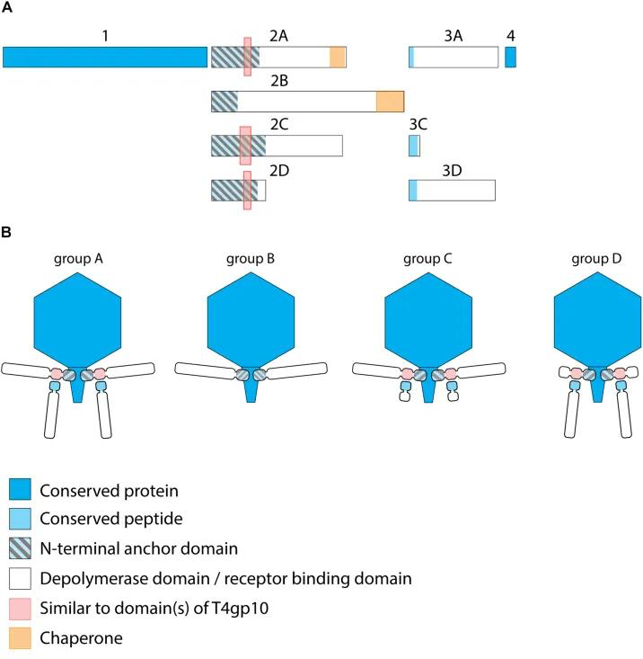
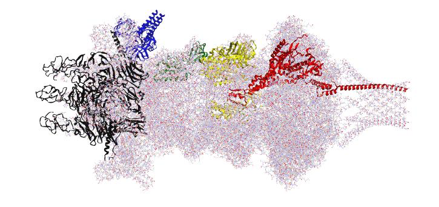

# 2026-07-29 — 與 Espinoza 教授的對話紀錄

> 對話發生在 2026-07-29 上午 10:50–11:17。Alex 問了五個問題，教授回了其中三個，
> 並且丟出一個**新的研究方向**和一個**新的製圖任務**。這份文件是那段對話的整理。
>
> 逐字引用保留英文原文；分析與判斷用中文。原始對話與圖片見本目錄。

---

# TODO

## Alex

| # | 事項 | 來源 | 備註 |
|:--|:-------------------------------|:-----------------|:----------------|
| A1 | **幫教授指認 host range 那頁的日期** | 他說要進實驗室拿表，但 "I will need help identifying the date" | 擋住他那邊，優先 |
| A2 | **數位化 06-12 之後的所有 lab notebook** | 你答應 "once I land in Ontario" | 7/4 那頁就在裡面 |
| A3 | **畫 virion cartoon**，仿 Latka 2019 group D | "You can draw a similar cartoon to that" | 必須 "justify this with synteny and similarity" |
| A4 | **把 virion 蛋白折出來做成可 3D 列印的物件** | "we could print the proteins and assemble it" | 顏色：baby blue |
| A5 | 看 [phagos.com](https://www.phagos.com/) 的工作與論文 | 教授："basically what we are trying to do" | |
| A6 | 整理一份 todo shortlist + 更新圖與摘要給教授過目 | 你自己答應的 | |
| A7 | 列 **fluorometer 零件清單** | "remember we are going to print a fluorometer" | 教授說你回來後他一次下單 |

## 教授

| # | 事項 | 狀態 |
|:--|:-------------------------------|:----------------|
| P1 | 進實驗室拿 **host range 表** | 這週，需要 A1 |
| P2 | 建 **GH5 全序列樹 + 祖先序列重建**，然後表現那些祖先酵素 | 進行中 |
| P3 | **表現 CDS_0010** 以做功能鑑定 | 三個構築已下單 |
| P4 | 消化他自己跑的 **MGnify** 搜尋結果 | "a lot of sequences! have not been able to digest" |

## 分析側（我們）

| # | 事項 | 為什麼 |
|:--|:-------------------------------|:--------------------------|
| C1 | **把 CDS_0010 改成 "unknown protein"** ——全 repo 與兩份 synthesis 文件 | 教授已明確放棄 glycosidase 說法（見下） |
| C2 | **做 synteny + similarity 的證據**來支撐 group D 歸類 | 教授指定，且是 cartoon 的前提 |
| C3 | 確認 CDS_20/08/09/13/14 的結構模組指認 | 教授說這幾條「沒有 TEM 也能說是 podo/T7-like」 |
| C4 | 待 host range 表到手後，更新 E4 / E5 / §4.5 | 我們現在寫的「從未測試」其實是「我們手上沒有」 |

---

# 教授回答了什麼

## 1. 構築 —— 已經下單，但標籤問題沒有正面回覆 ⚠️

> **Cesar:** I have placed the order for the first 3 constructs

**他沒有回應「檔名與序列不符」那一段。** 對話裡有兩則被截斷的訊息（`g on any of them`、`er group soon`），其中第一則看起來可能是在講構築，但**內容無法確認**。

→ 目前狀態：**N 端雙 His6、無 C 端標籤**這件事仍未經他確認是否為刻意設計。序列本身是對的（res 305–941 是乾淨的 β-helix body，N 端標籤也是我們建議的），所以影響有限，但**檔名要不要改、他知不知道，仍是開放的**。

## 2. CDS_0010 —— 確定是未知蛋白 ✅

> **Cesar:** Yeah I dont know what CDS 10 is
> **Cesar:** I thought it was a hydrolyase but not sure
> **Cesar:** I am expressing so maybe we can characterize it
> **Cesar:** but for now the focus is CDS11 and 12

**這條結案了。** 我們的模板分析（body 只有一個弱 IspD 命中、其餘 ~460 aa 無模板）跟他的判斷一致。全 repo 應該把 CDS_0010 從「教授說是 glycosidase 但不被支持」改成「**未知蛋白，已送表現以待功能鑑定**」。

## 3. Metagenome / 變異區 —— 他同意我們的顧慮 ✅

> **Cesar:** The metagenome side doesnt matter if they are not associated to any host

這正是 `2026-07-12_rbp_variable_region_plan_review.md` 的核心論點，他直接同意了。

但他同時說：

> **Cesar:** I was looking earlier and I think we can go bigger
> **Cesar:** and I did MGnify … to search for more sequences
> **Cesar:** a lot of sequences! have not been able to digest

⚠️ **注意：擴大搜尋並不解決宿主標註的問題。** MGnify 的序列同樣沒有宿主資訊，所以「更多序列」讓 MSA 更深，但仍然到不了「哪些位點決定結合」。他**沒有明確選擇**我們提的 (a) 保守度剖面 或 (b) 有標籤的 SDP 分析。這點需要再確認一次。

---

# 新方向：祖先 GH5 depolymerase

這是這次對話最重要的部分。教授的假說：

> **Cesar:** My current hypothesis (and this is how science works, directional changes ocurr)
> **Cesar:** is that CDS_12 (depolymerase) could improve host range by breaking different glycans
> **Cesar:** SO I am building a tree with all GH5 sequences and reconstruct acestrtal states to express them
> **Cesar:** if we challenge the affinity of the tail fiber and the differetn depolymerases in trans
> **Cesar:** maybe there affinity changes
> **Cesar:** all of this is under the caveat that the affinity ~ biding ~ infection
> **Cesar:** whihc is a safe assumption and we can make it clear

拆解：

1. **假說** —— CDS_0012（GH5）能**藉由分解不同的醣來拓寬宿主範圍**。
2. **方法** —— 建 GH5 全序列系統樹 → **祖先序列重建（ASR）** → 表現那些祖先酵素。
3. **實驗設計** —— 讓 tail fiber 與不同的 depolymerase **in trans** 組合，看親和力是否改變。
4. **他自己標明的前提** —— 假設 `affinity ~ binding ~ infection`，他認為這是安全假設但**要在文章裡寫清楚**。

**這對我們的敘事是一個轉向。** 原本 CDS_0012 是配角（「另一條蛋白，不是 tail spike 的 domain」），現在它是**可工程化的主角**：tail spike 決定認得誰，depolymerase 決定能咬開什麼。三個已下單的構築因此有了明確用途。

也和我們的 O-antigen 結果接得上：三株帶三套不同的 O-antigen 卡匣 → 如果 depolymerase 決定能處理哪種醣，那**換 depolymerase 就可能換宿主範圍**，而那正是他要用 ASR 去掃的空間。

---

# 新任務：virion cartoon 與 group D 歸類

> **Cesar:** Our phage is a T7-like podophage
> **Cesar:** Basically looks similar to group D,
> **Cesar:** the long one is the tail (CDS 11) and short one (at least one) is the depolymerase
> **Cesar:** You can draw a similar cartoon to that
> **Cesar:** you need to justify this with synteny and similarity

## 他指定的結構模組

> **Cesar:** basically CDS 20, 08, 09, 13, 14 … maybe not 20
> **Cesar:** 20, 8, 9, 13, 14 really tell (without TEM) that it is a podo/t7 like
> **Cesar:** by syntenic assumptions (10,11,12) are the ones that hang from the base and recognize the host
> **Cesar:** 12 is a depolymerase but we dont know what 10 is

| CDS | 教授的指認 | 我們的註解（canonical `UUAIURNK_`） |
|:-----|:-------------------------|:-----------------------------------------|
| 0020 | funnel / base plate（"maybe not 20"） | portal protein, 742 aa |
| 0008 | 同上 | internal virion protein, 577 aa |
| 0009 | 同上 | tail fiber protein, 118 aa |
| 0013 | 同上 | virion structural protein, 201 aa |
| 0014 | 同上 | structural protein, 232 aa |
| 0010 | 從 base 垂下、辨識宿主 | tail protein, 917 aa —— **未知功能** |
| 0011 | 「長的那條」＝ tail | tail spike, 941 aa —— β-helix depolymerase |
| 0012 | 「短的那條」＝ depolymerase | GH5 TIM barrel, 477 aa |

## ⚠️ 一個值得追查的觀察

cartoon 的出處是 **Latka, Leiman, Drulis-Kawa & Briers (2019), *Front. Microbiol.* 10:2649,
"Modeling the Architecture of Depolymerase-Containing Receptor Binding Proteins in *Klebsiella* Phages"**（DOI [10.3389/fmicb.2019.02649](https://doi.org/10.3389/fmicb.2019.02649)）。

按該文的定義，**group D 的第一條 RBP「不含酵素或受體結合域，只帶一個含 T4gp10-like 片段的 N 端錨定域」，第二條 tail fiber 才是完整的 RBP。**

把這個定義套到我們的基因：

- **CDS_0010** 有 Calx-β 錨定（與 CDS_0011 的錨定 42% 相同）、body 沒有任何模板 → **正好符合 group D 那條「有錨定、無酵素域」的第一 RBP**。
- **CDS_0011** 錨定 + β-helix depolymerase body → 符合「完整 RBP」的第二條。

**如果成立，group D 的歸類本身就預測了 CDS_0010 沒有酵素域** —— 這與我們的模板分析（~460 aa 無模板）和教授自己的「I don't know what CDS 10 is」是三條獨立證據指向同一件事。

⚠️ 但要注意兩點：(1) 該文研究的是 *Klebsiella* KP32 podovirus，我們是 *Pseudomonas*，所以是**類比套用**——這正是他要求「justify with synteny and similarity」的原因；(2) 我還**沒有檢查 CDS_0010 是否真的帶 T4gp10-like 片段**，那是這個假說最直接的檢驗點。

---

# 3D 列印

> **Cesar:** if its expensive to print 3d figures
> **Alex:** no / I will pay for it
> **Cesar:** we could print the proteins and assemble it
> **Cesar:** the funnel and base place fibers and depolymerase

- **要印的**：funnel + base plate（CDS 20/08/09/13/14）、fibers 與 depolymerase（CDS 10/11/12）
- **顏色**：baby blue（教授說 "its up to you"）
- **來源**：可以用教授的 AF3 折疊，Alex 說也會自己折一份
- **另一個列印專案**：fluorometer —— Alex 列零件清單，教授在他回來後一次下單

---

# 仍然開放的問題

| 問題 | 狀態 |
|:----------------------------------|:--------------------------------|
| 「our three isolates」指哪三株？ | **完全沒回答**（訊息似乎被截斷） |
| 構築檔名 vs 序列的標籤不符，是刻意的嗎？ | **沒有正面回覆** |
| 變異區要 (a) 保守度 還是 (b) 有標籤的 SDP？ | 他同意 metagenome 沒宿主就沒用，但沒選 |
| MGnify 那批序列裡有沒有值得注意的東西？ | 他說還沒消化 |
| 我們找到的**第二個 depolymerase CDS_0024** 在他的模型裡是什麼？ | **沒提過** —— 它不在 10/11/12 那個 cluster 裡 |

---

# 圖片

第一張出自 Latka *et al.* 2019（Frontiers，開放取用），僅供內部參考；若要用於對外簡報或 wiki，需依 CC-BY 標註原作者與出處。

---

*Log — 2026-07-29：建立。整理 2026-07-29 10:50–11:17 與 Espinoza 教授的對話。
教授確認 CDS_0010 為未知蛋白（我們的模板分析獲得支持）、同意 metagenome 序列若無宿主標註則無用、
並提出以 GH5 祖先序列重建拓寬宿主範圍的新方向。新增製圖任務：仿 Latka 2019 group D 的 virion cartoon，
需以 synteny + similarity 佐證。查證 cartoon 出處為 Latka et al. 2019 Front. Microbiol. 10:2649，
並注意 group D 的定義本身可能預測 CDS_0010 無酵素域（待驗證 T4gp10-like 片段）。
構築標籤問題與「三株指哪三株」仍未獲回覆。*
