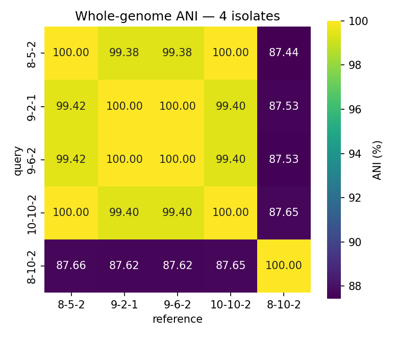
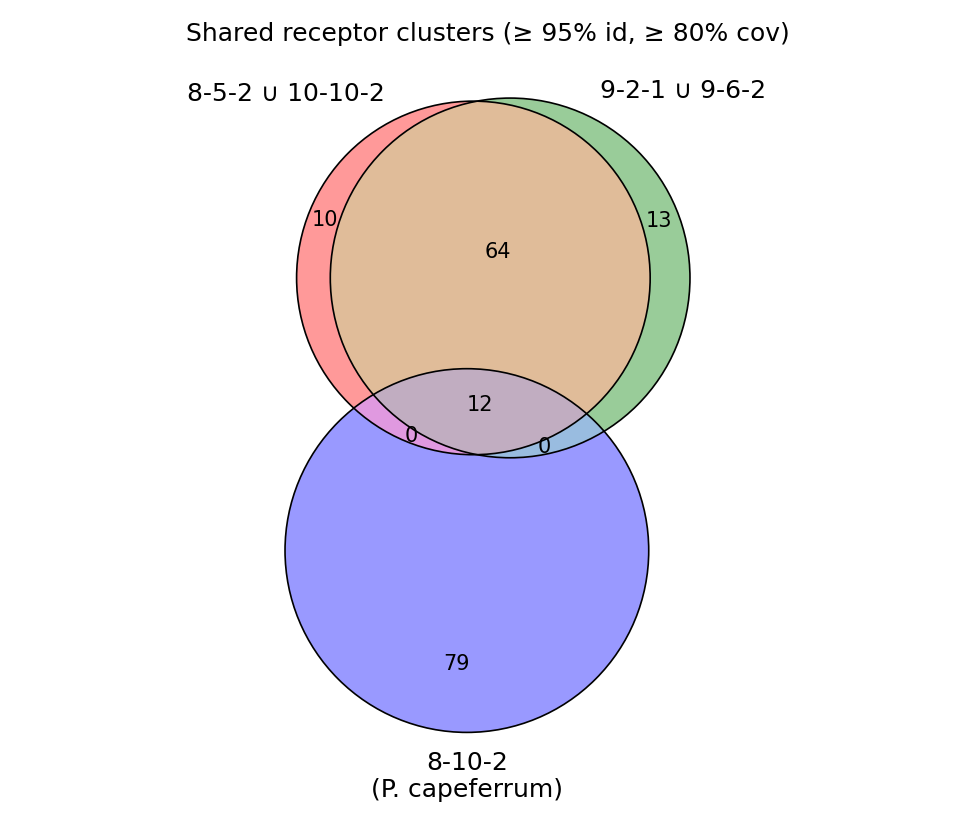
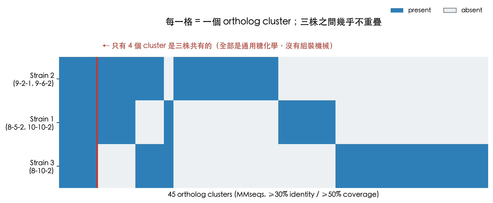
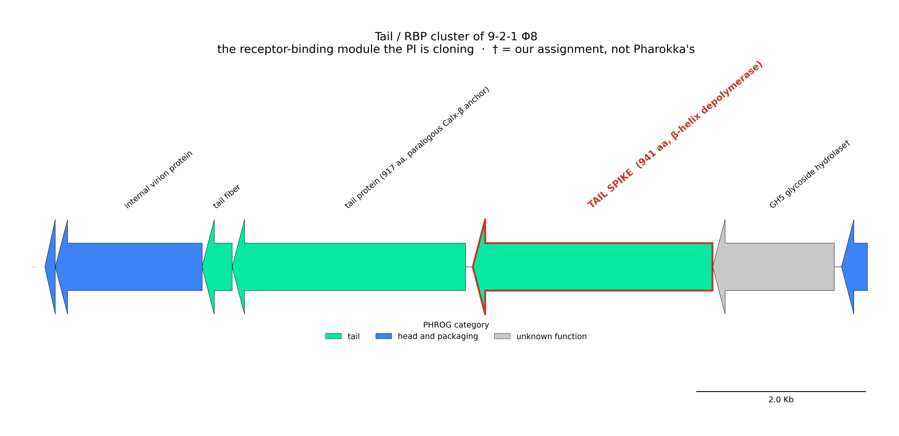
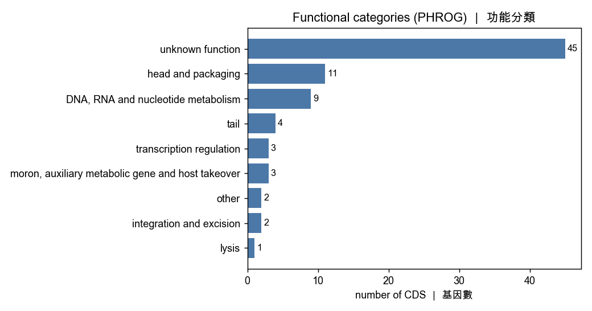
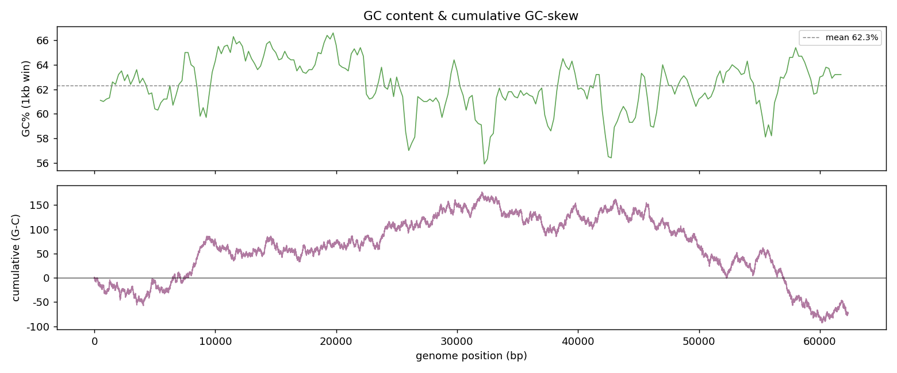
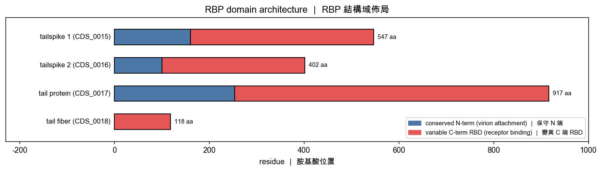
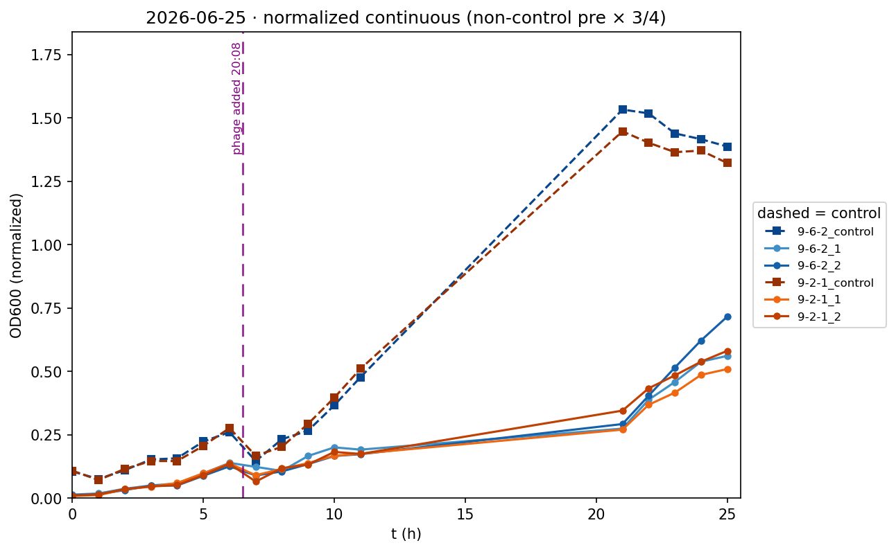
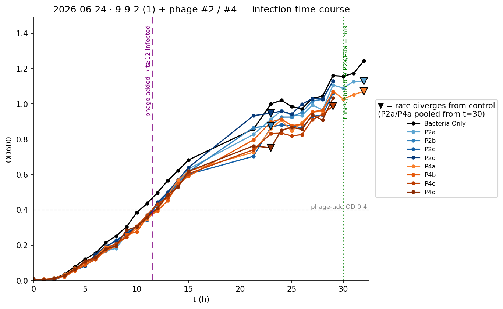
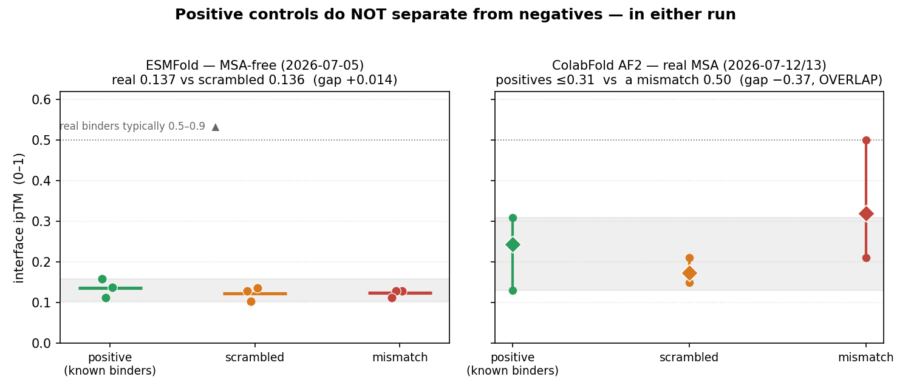

::: {.callout-note title="What this document is"}
Prof. Espinoza's email of 2026-07-27 opened seven items, one of them marked
immediate. This document connects those seven to everything we currently have:

- **§1** the seven items unpacked — what was asked, what it actually requires, where each stands.
- **§2** what our material actually is — five isolates are three strains, and there is only one phage. Every number later rests on this.
- **§3** a complete results table — every result in the repository, with an evidence grade and where it can be used.
- **§4** the full answer to item 7 — the O-antigen locus comparison.
- **§5** next steps, and three things we need from the PI.
- **Appendix** figures, how each was made, and a source map.

§1–§3 and §5 are an index and a status report; §4 is a complete analysis.
This is the English counterpart of
[`2026-07-28_results_synthesis.qmd`](2026-07-28_results_synthesis.qmd); the two
are kept in sync.
:::

# The seven questions

## What was asked, and what it requires

| # | The PI's words | What is actually being asked for | What we are really looking at | Status |
|:-|:--------------|:------------|:-------------|:-----|
| **1** | *Let's start synthesizing our results so we can begin preparing figures for your presentation(s) and manuscript(s).* | Pull scattered results into usable figures and tables | Two audiences: **manuscripts** (the MRA, and a later phage paper) and the **iGEM presentation / wiki** | 🟢 **this document** |
| **2** | *I suggest creating a graphical abstract that summarizes the overall project.* | One figure for the whole project | Needs §3 to settle first, and the central claim still lacks wet-lab support | 🔴 not started |
| **3** | *Prepare a diagram of the bacterial genomes we sequenced.* | A visual of the bacterial genomes | Five isolates → three strains, one circular map each | 🟢 **done → Appendix A5** |
| **4** | *Create a genome map of our phage highlighting the structural proteins, particularly the tail spike protein.* | Phage genome map with structural proteins marked | 80 CDS, redrawn on the canonical coordinates | 🟢 **done → Appendix B1, B2** |
| **5** | *Generate a 3D model of the tail spike protein, highlighting the variable regions identified from the metagenomic analysis.* | Tail spike 3D + variable regions | **The model exists, but the "metagenomic variable-region analysis" does not** — and the original plan was rejected on methodological grounds by our own review | 🔴 blocked (§1.3) |
| **6** | *Generate 3D models of the enzymatic domains within the tail spike protein.* | 3D of the enzymatic domains | AF3 folds and the domain map were already complete | 🟢 **done → Appendix B3** |
| **7** | *(immediate)* *identify bioinformatics tools capable of predicting the O-PS type from bacterial genome sequences, and compare across our three isolates* | O-antigen typing + a three-way comparison | **No tool applies**; we compared the loci directly instead | 🟢 **done → §4** |

## These seven are really two threads

**The first is deliverables** (1, 2, 3, 4, 6). The underlying data was already on
disk; what was missing was the drawing. These were not hard — the hard part was
*not drawing them wrong*: the existing phage figure was mirrored, two CDS
numbering schemes coexist, and one of the "enzymatic domains" is unsupported.

**The second is a real scientific question** (7, and the blocked 5). Item 7 turns
out to be where the whole storyline closes:

```
we have phage 9-2-1 Φ8 + three host strains
        ↓
the tail spike is a β-helix depolymerase (a sugar-degrading enzyme)
        ↓
therefore the receptor is the host-surface O-antigen SUGAR, not a protein
        ↓  ← which is why protein–protein docking was falsified and retired (§3, group F)
therefore what should be compared is the strains' O-antigen loci      ← item 7
        ↓
and the three strains do carry three non-homologous cassettes         ← §4
        ↓
→ yielding a falsifiable prediction: Φ8 should not plaque on the other two
```

## Why item 5 is blocked

The "metagenomic variable-region" analysis the PI refers to **has never been
done**, and
[`2026-07-12_rbp_variable_region_plan_review.md`](2026-07-12_rbp_variable_region_plan_review.md)
already stress-tested the original plan and concluded it cannot be run as
designed:

- **A central methodological error** — *a variable region is not a
  specificity-determining position*. What matters is SDPs (positions conserved
  *within* a functional subgroup and different *between* subgroups), not raw
  high-entropy columns, most of which are neutral drift.
- **A fatal data gap** — MGnify / metagenome sequences carry **no host or
  receptor labels**, so there is no way to get from sequence to "what does this
  RBP bind".

That review ends on three questions awaiting a decision, and states explicitly
that no code should be written until the label source is settled.

**Half of it can still be salvaged.** The PI's own AF3 job folders contain an
alignment of **15,775 sequences** for CDS_0011 — deep enough to compute a
per-residue conservation profile and paint it onto the structure. That is an
honest figure (conserved core vs variable surface). The caption must say it
shows **conservation**, which is not the same as "the positions that determine
binding".

# What our material actually is

Everything downstream rests on this section.

## Five isolates, three strains

`data/bacteria_genome/` holds **five** isolates. Per
`code/0627_unique_strain_table.ipynb` they collapse into **three ANI-distinct
strains**:

| Strain | Isolates | Species (GTDB) | Genome | Note |
|:-----|:------------|:-----------|:------|:-----------|
| **Strain 1** | 8-5-2, 10-10-2 | *Pseudomonas_E* sp013179515 | ~5.93 Mb | 99.997% ANI to each other |
| **Strain 2** | 9-2-1, 9-6-2 | *Pseudomonas_E* sp013179515 | ~6.18 Mb | **100.000%** ANI to each other; **the phage host** |
| **Strain 3** | 8-10-2 | ***P. capeferrum*** | ~5.70 Mb | 87.4–87.7% ANI to the others — a different species |

Strain 1 and Strain 2 sit at 99.38–99.42% ANI: same species, different strains,
but ~250 kb apart in genome size.

::: {.callout-caution title="Two things to be careful about"}
1. **We have not confirmed which three the PI meant by "our three isolates".**
   We assume the three strain representatives. This needs one line from him (§5).
2. The MRA draft
   ([`2026-06-27_MRA_Pseudomonas.docx`](2026-06-27_MRA_Pseudomonas.docx))
   covers only the four *sp013179515* isolates and **excludes 8-10-2**, so the
   MRA says "two strains" while this document says three. That is a **difference
   in scope, not a contradiction**.
:::

## There is only one phage

**9-2-1 Φ8** is the only phage sequenced so far: a single contig of **62,338 bp**
(**62,416 bp** in the PI's assembly), linear, with a **77 bp direct terminal
repeat** at both ends, and 80 CDS. It was isolated on site 9-2-1; its host is
**Strain 2**.

**9-6-2 Φ8 has not been sequenced** (same 06/05 plaque batch).

::: {.callout-warning title="Two CDS numbering schemes coexist"}
The same phage was annotated twice, on **opposite assembly orientations**, so the
CDS numbers run in opposite directions (77 of 80 are the same protein, simply
renumbered).

**The PI's `UUAIURNK_` numbering has been canonical since 2026-07-16**; our older
`FHABPWTM_` numbers are deprecated. Convert via
`code/0713_espinoza_structural_mapping/cds_lookup.tsv`. Anything written before
2026-07-16 may still use the old numbers.

The easiest trap: the PI's **CDS_0011 (tail spike, 941 aa)** corresponds to
**CDS_0015 + CDS_0016 merged** in our old annotation — draw from the old GFF and
the tail spike splits into two ORFs.
:::

# Complete results table

::: {.callout-tip title="How to read the evidence grades"}
| Mark | Meaning |
|:-----|:-------------------------------------------|
| ✅ | **Confirmed** — data plus controls or agreement between independent methods |
| 🟡 | **Provisional** — computational inference, single method, no experimental test |
| 🔴 | **Incomplete, or explicitly a prediction** — must not be cited as a result |
| ⛔ | **Negative result** — attempted, failed, retired. **Valuable, and publishable** |
:::

## A. Bacterial hosts

| # | Result | Evidence | Source | Use |
|:-|:-------------------------|:---|:-----------|:-----|
| A1 | **Complete closed genomes for all five isolates**: single circular contig each, ONT + Autocycler; CheckM completeness 99.74–100.00% | ✅ | `data/bacteria_genome/` | paper·talk·wiki |
| A2 | Genome sizes 5.70–6.18 Mb; GC 62.4–62.6%; sequencing depth 67–96× | ✅ | `code/output/0626_genome_comparison/table1_genome_summary.csv` | paper |
| A3 | **Five isolates collapse to three ANI-distinct strains** (§2.1) | ✅ | `code/0627_unique_strain_table.ipynb` | paper·talk·wiki |
| A4 | Taxonomy: four isolates are ***Pseudomonas_E* sp013179515**; 8-10-2 is ***P. capeferrum*** | ✅ | sourmash / GTDB | paper |
| A5 | Closest public relative is *Pseudomonas* sp. **CM27** at ~99.2% ANI; **not** *P. aeruginosa* (80.4%) and not *P. putida* (89.4%) | ✅ | `code/0623_metagenome_rbp/out_finding_rbps/ani/` | paper·wiki |
| A6 | Bakta annotation complete: 5,055–5,449 CDS per isolate, coding density ~89.6% | ✅ | `data/bacteria_genome/*/annotation/` | paper |
| A7 | **Surface-receptor mining: 441 candidate receptors → 178 clusters**; 86–91 per isolate; **12 shared by all five**; 79 unique to 8-10-2 | ✅ | `code/0626_genome_comparison.ipynb` | paper·talk |
| A8 | Receptor classification against 13 *E. coli* OMP references: of 237, **156 unclassified**, fhuA 41, btuB 12, ompA 12, yncD 7, tolC 6, tsx 3 | 🟡 | `code/output/0620_receptor_classification/class_summary.tsv` | paper |
| A9 | **The three strains carry three non-homologous O-antigen cassettes** in the same `ihfB`-flanked slot; only **4 of 45** ortholog clusters are shared by all three | ✅ | **§4** | **paper·talk·wiki** |
| A10 | Both clone pairs have **100.0% identical** O-antigen cassettes (internal control passed) | ✅ | **§4.4** | paper |
| A11 | All five carry a complete 12-gene **alginate operon** (`algD–algA`); **no psl locus** | 🟡 | Bakta annotation | paper |
| A12 | The dTDP-rhamnose pathway is complete in all three strains but differently arranged (Strain 3 keeps the whole operon outside the cassette) | ✅ | **§4.3** | paper |

## B. Phage genome

| # | Result | Evidence | Source | Use |
|:-|:-------------------------|:---|:-----------|:-----|
| B1 | **Complete 9-2-1 Φ8 genome**: single contig **62,338 bp** (PI's assembly 62,416 bp), GC 62%, ~1014× coverage | ✅ | `data/phage_genome/9-2-1/assembly/` | paper·talk·wiki |
| B2 | **Topology resolved: linear with a 77 bp direct terminal repeat** (not circular) | ✅ | `.../assembly/NOTES.md` | paper |
| B3 | Pharokka annotation: **80 CDS**, coding density 96.3%, 2 tRNA, 0 CRISPR | ✅ | `code/0713_espinoza_structural_mapping/pharokka_espinoza/` | paper |
| B4 | **Structural module mapped**: 11 head & packaging, 3 tail (CDS_0009/0010/0011), major head CDS_0017, portal CDS_0020, internal virion protein CDS_0008 | ✅ | as above | paper·talk·wiki |
| B5 | **Safety: zero VFDB virulence factors, zero CARD resistance genes** | ✅ | `.../top_hits_{vfdb,card}.tsv` | **safety forms·wiki** |
| B6 | No mash hit against INPHARED → a novel phage | 🟡 | `pharokka_top_hits_mash_inphared.tsv` | paper·wiki |
| B7 | Two integration & excision genes annotated → **possibly temperate** | 🟡 | Pharokka categories | paper (safety) |
| B8 | The PI's structural annotation: AlphaFold + foldseek matched the virion to *Ralstonia* phage **GP4** (a podovirus) | 🟡 | `code/0713_espinoza_structural_mapping/` | talk |
| B9 | **CDS numbering crosswalk** (PI's `UUAIURNK_` ↔ our `FHABPWTM_`; 80 rows, sequence-verified, 77/80 identical) | ✅ | `.../cds_lookup.tsv` | internal, essential |
| B10 | **The large terminase subunit is not annotated** (only the small subunit, CDS_0027) → formal taxonomy (terL tree / VIRIDIC) **cannot be run** | 🔴 | `terL.faa` is 0 bytes | blocks the formal claim in B6 |
| B11 | 9-6-2 Φ8 **not yet sequenced** | 🔴 | `NOTES.md` UNDONE | — |

## C. Tail spike and enzymatic domains

| # | Result | Evidence | Source | Use |
|:-|:-------------------------|:---|:-----------|:-----|
| C1 | **The tail spike CDS_0011 (941 aa) is a right-handed β-helix depolymerase** — backbone H-bond rung period 15–18, pLDDT 88–94 | ✅ | `code/0712_phage_rbp_detect/`, `0716_espinoza_fiber_construct/` | **paper·talk·wiki** |
| C2 | **→ the primary receptor is the LPS O-antigen (a sugar), not a protein** — the pivot of the whole project | ✅ | `2026-07-13_phage_rbp_depolymerase_findings.md` | **paper·talk·wiki** |
| C3 | **CDS_0011 domain map**: Calx-β β-sandwich 1–110 (joins the capsid base) / shaft 111–300 (AF3 cannot place it; 41–52 Å RMSD between models) / **rigid trimeric body 301–941** (0.44–0.99 Å RMSD) | ✅ | `code/0716_espinoza_fiber_construct/domain_map.tsv` | paper·talk |
| C4 | **CDS_0012 is a GH5 glycoside hydrolase (TIM barrel)** — all four AF3 templates are GH5 endoglucanases, including **1ECE with cellotetraose bound**, over res 118–475, pLDDT 95–98 | ✅ | as above | paper·talk |
| C5 | **CDS_0024 is a second β-helix depolymerase** (rung period 22–24), **missed by Pharokka** (annotated "hypothetical"), found by RBP Detect (score 0.998) | ✅ | `code/0712_phage_rbp_detect/` | paper·talk |
| C6 | CDS_0010 and CDS_0011 **share the same Calx-β anchoring module** (42% identity over 107 aa) → paralogous fibers | ✅ | `code/0716_espinoza_fiber_construct/` | paper |
| C7 | **The PI's claim that CDS_0010 is also a glycosidase is not supported** — one weak IspD hit; the remaining ~460 aa have no template | 🔴 | as above | needs his evidence (§5) |
| C8 | **Three constructs were sent to Twist on 2026-07-27** (rush + glycerol stocks): CDS_0011 **res 305–941**, CDS_0010 res 105–917, CDS_0012 res 117–477, all in pET-28a(+) | ✅ | `documents/2026-07-27_twist_construct_order/` | paper·wiki |
| C9 | ⚠️ **The construct filenames contradict their sequences**: `CDS11_WT_CTERM_HIS6TAG` actually carries **two N-terminal His6 tags and no C-terminal tag** (the insert's own stop codon precedes the vector tag); both `NOTAG` constructs do carry pET-28a's N-terminal His6 | ✅ | as above, verified by translating each plasmid | must be corrected internally |
| C10 | The β-helix call has **no named structural homolog yet** — no foldseek/DALI run (not available locally) | 🔴 | UNDONE | — |

## D. RBP databases and metagenomes

| # | Result | Evidence | Source | Use |
|:-|:-------------------------|:---|:-----------|:-----|
| D1 | **Literature RBP database: 1,673 unique sequences** (3 papers, 2,447 source records), of which **115 are Pseudomonas** | ✅ | `code/0619_literature_rbp_database/` | paper·wiki |
| D2 | RBP-by-receptor table, 1,215 rows; **173** high-confidence (experimentally or AF3 validated); 362 in the *E. coli* OMP class | ✅ | `rbp_by_receptor_class.tsv` | paper |
| D3 | **De novo RBP detection in the metagenomes** (PhageRBPdetect v4 / ESM-2): MG08 **632**, MG09 **661** | ✅ | `code/0701_phagerbp_metagenome/` | paper |
| D4 | **Surrogate-host analysis**: *P. putida* shares the most receptors with us (68 at ≥90% identity, max 99.4%); KT2440 has 71 phage records in PharBP | 🟡 | `code/output/0703_phage_host_matrix/host_overlap_summary.md` | paper·talk |
| D5 | **Methodological finding: PharBP is an RBP database, not a receptor database** — it has no bacterial-receptor field, so our receptor sequences cannot be looked up there | ✅ | `code/0701_pharbp_query/` | internal·paper (methods) |
| D6 | The metagenome RBPs have **never been aligned to CDS_0011** — the input item 5 presumes does not exist | 🔴 | — | blocks item 5 |

## E. Wet lab

| # | Result | Evidence | Source | Use |
|:-|:-------------------------|:---|:-----------|:-----|
| E1 | **DNA quantification standard curves, 5 batches** (Portelite / Qubit BDR): 0605, 0608, 0622, 0629, 0710 | ✅ | `code/output/*_quantification/` | paper (methods)·wiki |
| E2 | **OD600 phage-challenge time course (0624)**: host 9-9-2 × two plaque picks, phage added at OD 0.4, hourly to 24 h, infection scored by divergence of ΔOD from the control | ✅ | `code/0624_od600_phage.ipynb` | paper·talk·wiki |
| E3 | **OD600 phage-challenge time course (0625)**: 9-6-2 and 9-2-1 each × p8, phage added at a fixed time (20:08), with a 3/4 dilution correction | ✅ | `code/0625_od600_phage.ipynb` | paper·talk·wiki |
| E4 | **Host range has only ever been tested on Strain 2** (9-2-1, 9-6-2) — 8-5-2, 10-10-2 and 8-10-2 have **never been challenged** | 🔴 | `data/assays/` | determines the next step |
| E5 | **Prediction: Φ8 should not plaque on Strain 1 or Strain 3** (from A9 + C2) | 🔴 **prediction** | **§4.5** | the next experiment |

## F. Negative results (publishable, and worth publishing)

| # | Result | Evidence | Source | Use |
|:-|:-------------------------|:---|:-----------|:-----|
| F1 | **The RBP × OMP protein–protein docking screen does not work**: across a 9-fold control gate, positives scored ipTM ≤0.31 while a mismatched pair scored 0.50 → **no discriminating power**; the 120-pair screen was never run | ⛔ | [`2026-07-13_why_protein_protein_binding_fails.qmd`](2026-07-13_why_protein_protein_binding_fails.qmd) | **paper·talk** |
| F2 | The reason is understood: **phage × bacterium is cross-kingdom, so there is no paired MSA** and no interface co-evolution signal | ⛔ | as above | paper (methodological contribution) |
| F3 | The earlier 7,182-pair ESMFold screen was reading **protein size**, not binding (score–length r = +0.58) | ⛔ | `code/0703_phage_host_matrix/` | paper |
| F4 | **single_sequence folding is unusable** (pLDDT ≈ 30); a real MSA is required (mostly >80) | ⛔→✅ | `code/0712_phage_rbp_detect/` | paper (methods) |
| F5 | **The variable-region plan is methodologically flawed**: variable ≠ specificity-determining, and MGnify carries no host labels, so SDP methods cannot run | ⛔ | [`2026-07-12_rbp_variable_region_plan_review.md`](2026-07-12_rbp_variable_region_plan_review.md) | internal (blocks item 5) |
| F6 | **No O-PS serotyping tool applies** (PAst is *P. aeruginosa*-only; Kaptive has no Pseudomonas database), and this taxon has no reference serotype scheme at all | ⛔→✅ | **§4.1** | **paper — this is the answer to item 7** |

## G. Manuscripts and deliverables

| # | Result | Evidence | Source | Use |
|:-|:-------------------------|:---|:-----------|:-----|
| G1 | **The MRA draft is written** (Chen, Wang, Yan, Escobar, Ignacio-Espinoza): four isolates, two strains, full methods section and Table 1 | 🟡 | [`2026-06-27_MRA_Pseudomonas.docx`](2026-06-27_MRA_Pseudomonas.docx) | paper |
| G2 | ⚠️ **Every GenBank / SRA accession is still `pending`** and data availability is still `XXX` → **submission is blocked on deposition, not on analysis** | 🔴 | as above | blocks G1 |
| G3 | The MRA excludes 8-10-2, which is why it says "two strains" where this document says three — scope, not contradiction | ✅ | §2.1 | internal consistency |

# Item 7 in full: the O-antigen locus comparison

::: {.callout-important}
**No tool applies.** Every in-silico O-PS serotyper is species-bound and ours is
none of the supported species; this taxon has no reference serotype scheme, so
**no O-type name can be assigned to any of our strains**.

Comparing the loci directly instead: **the three strains each carry a
non-homologous O-antigen cassette in the same genomic slot.** Of 45 ortholog
clusters, only **4** are shared by all three, and all four are generic sugar
chemistry — **none of the assembly machinery is shared**.

Because our tail spike is a sugar-degrading enzyme whose receptor is that very
O-antigen, this difference predicts directly that **Φ8 should not plaque on the
other two strains**.
:::

## Why no existing tool applies

O-PS (O-polysaccharide, or O-antigen) is the outermost repeating sugar chain of
the LPS in Gram-negative bacteria, and one of the most variable surface
structures between strains. In-silico serotypers all work by matching a genome
against a **species-specific reference database of serotypes** — so whether a
tool is usable is entirely a question of species.

| Tool | Scope | Why it does not apply |
|:---------|:-------------|:-------------------------|
| **PAst / PAst2.0** | *P. aeruginosa* OSA clusters O1–O20 | our isolates are ~**80% ANI** to PAO1 — a different species |
| **Kaptive** (all versions) | *Klebsiella*, *A. baumannii*, third-party *V. parahaemolyticus* | **no Pseudomonas database exists** |

::: {.callout-warning title="Please keep this distinction"}
What we can deliver is that **the locus architecture differs**. We cannot deliver
"Strain 1 is O-type X" — that does not exist for this taxon.
:::

## Method

### Anchors rather than coordinates

An O-antigen locus is a variable cassette dropped into a conserved slot, so its
position differs in every genome and the only stable landmark is its flanks. In
all five genomes the upstream flank reads:

```
30S ribosomal protein S1
  → integration host factor subunit β (ihfB)
    → lipopolysaccharide assembly protein A
      → MBL fold metallo-hydrolase
        → [the variable O-antigen cassette starts here]
```

`ihfB` (also known as *himD*) is the canonical upstream flank of the
*Pseudomonas* OSA cluster in the literature, so this anchor is principled rather
than arbitrary.

### Orthology decided by sequence, not by product name

Bakta will give two entirely unrelated glycosyltransferases the same product
string, so calling genes shared or unique from labels would manufacture false
overlap. Orthology here is decided by **MMseqs2 clustering** (≥30% identity,
≥50% coverage).

This paid off immediately: the chain-length regulators of Strain 1 and Strain 2
carry **two different Bakta labels** (`O-antigen chain length regulator` vs
`Polysaccharide chain length determinant`) but the sequences show they are
homologous — comparing by name would have missed it.

## Results: three strains, three cassettes, one slot

| Strain | Locus tags | Genes | Span |
|:---------|:---------------------|:-------|:---------|
| **Strain 2** (9-2-1, 9-6-2) | `OHPLIO_01276–01298` / `PICBEH_01275–01297` | 23 | 26.5 kb |
| **Strain 1** (8-5-2, 10-10-2) | `PEMOGA_01378–01392` / `BPBBIK_01378–01392` | 15 | 17.0 kb |
| **Strain 3** (8-10-2) | `NEEDOG_01333–01357` | 25 | 38.2 kb |

**Distinctive content.** **Strain 2** carries a UDP-GlcNAc →
2,3-diacetamido-uronic acid route (`wbpA/wbpB/wbpD`-type), a DegT
aminotransferase, `wzx`, a repeat-unit polymerase (`wzy`), `wbuB`, and an
acetamidino modification module (amidotransferase + HisH + AglZ/HisF2).
**Strain 1** carries `wbpL`, `epsG`, `capD` and four glycosyltransferases, with
none of Strain 2's amino-uronic route. **Strain 3** carries an O-antigen ligase,
a separate polymerase, a D-glucuronyl C5-epimerase, a UDP-ManNAc dehydrogenase,
and one 6.7 kb ORF (`NEEDOG_01355`).

**The dTDP-rhamnose pathway is complete in all three**, but differently
arranged: Strains 1 and 2 place `rfbA/rfbB/rfbD` at the end of the cassette with
`rmlC` elsewhere in the genome (`OHPLIO_00244`, `BPBBIK_00248`), while Strain 3
keeps the whole four-gene operon *outside* the cassette (`NEEDOG_00269–00272`,
`rmlC` included) and retains only a lone `rfbD` inside it.

See **Appendix A3** for the main figure and **A4** for the cluster matrix.

## The clone pairs are the control, and they pass

This step is not optional. The whole argument is that **ANI saturates while
accessory loci diverge** — so we could not simply *assume* that 100%-ANI clones
share this locus; it had to be measured.

- **9-2-1 vs 9-6-2** — all 23 genes hit at **100.0%** mean identity, on identical
  coordinates (1,409,400–1,435,896).
- **8-5-2 vs 10-10-2** — all 15 genes at **100.0%**.

**Across strain groups the cassettes barely correspond:**

| Comparison | Genes with a best hit | Mean identity | Median |
|:---------------|:-------------|:---------|:---------|
| Strain 2 ↔ Strain 1 | 9 of 23 | 71.9% | 67.4% |
| Strain 2 ↔ Strain 3 | 10 of 23 | 54.7% | 49.4% |
| Strain 1 ↔ Strain 3 | 6 of 15 | 63.5% | 61.7% |

::: {.callout-note title="Why these counts deliberately do not reconcile with the cluster counts"}
These are **best-hit-per-query in one direction, not reciprocal best hits**, and
they use a looser cutoff (20% identity / 40% coverage) than the clustering below
(30% / 50%). The two sets of numbers are **not meant to add up** — a gene can
have a weak best hit without joining an ortholog cluster.
:::

Of **45 ortholog clusters** (30% / 50%) across 101 cassette proteins, only **4**
are shared by all three strains: a UDP-glucose 4-epimerase, a GT-family-4
transferase, a CapD-like protein and an SDR oxidoreductase. All generic sugar
chemistry; **none of it assembly machinery** — no shared flippase, polymerase or
chain-length regulator, i.e. none of the parts that determine what the O-antigen
actually looks like. Strains 1 and 2 additionally share the dTDP-rhamnose trio
and the chain-length regulator.

## What this predicts — and what it does not

Two facts combine: **(1)** the tail spike is a β-helix depolymerase, so the
receptor is the O-antigen sugar (C1, C2); **(2)** the three strains' O-antigen
cassettes are non-homologous (A9).

If this phage's depolymerase reads Strain 2's sugar, it should **not** infect the
other two. Current evidence is shown in **Appendix C1**.

::: {.callout-important title="The experiment we recommend next"}
**Spot-assay 9-2-1 Φ8 against 8-5-2, 10-10-2 and 8-10-2.**

- **No plaques** → the O-antigen mechanism of host range is confirmed and the
  storyline closes.
- **Plaques** → more interesting still: the second depolymerase (`CDS_0024`, C5)
  is acting, and the phage has two sugar specificities.

**Either outcome is publishable.** This is the highest-value experiment available
at this stage.
:::

## Limits — what cannot be said yet

::: {.callout-caution}
1. **Do not say the O-antigen difference explains our observed host range.**
   There is no cross-strain plaque data at all. This is a **prediction**, not an
   explanation.
2. **No serotype can be named.** Every conclusion rests on Bakta product
   strings — gene annotation, not determined sugar structure — and this species
   has no reference serotype scheme.
3. **Strain 1 appears to lack a flippase and a polymerase; that is most likely an
   annotation artifact.** Its `Polysaccharide biosynthesis protein` and
   `EpsG family protein` are the usual labels for Wzx- and Wzy-family proteins,
   but Bakta assigns them no Pfam/InterPro domain here (UniRef50 only). They are
   left grey and unassigned in Appendix A3 rather than coloured on a guess.
   Confirming them needs InterProScan.
4. **The sugar structure itself has not been measured.** Gene content is not
   structure; that requires LPS extraction and mass spectrometry.
:::

# Next steps

| Priority | Item | Who | Why |
|:----|:---------------------|:-------|:--------------|
| 1 | Ask the PI whether the **CDS11 tagging is deliberate** (C9) | Alex | Twist has not confirmed processing yet — this is the window |
| 2 | **GenBank / SRA deposition** (G2) | Alex | blocks the MRA submission |
| 3 | **Spot assay**: Φ8 × 8-5-2 / 10-10-2 / 8-10-2 (E5) | wet lab | highest value on the list; either outcome is publishable |
| 4 | Conservation profile painted on the structure (the salvageable half of item 5) | analysis | the 15,775-sequence MSA already exists |
| 5 | Graphical abstract (item 2) | TBD | only items 2 and 5 remain open, so this can start |
| 6 | Sequence 9-6-2 Φ8 (B11) | wet lab | the second phage |
| 7 | Confirm the Wzx/Wzy family assignments (§4.6, limit 3) | analysis | needs InterProScan, not available locally |
| 8 | Foldseek naming of the tail spike β-helix family (C10) | analysis | the fold call currently has geometric evidence only |

**Completed 2026-07-29**: items 3, 4 and 6 — see `code/0729_prof_figures/`.

::: {.callout-important title="Three things we need from the PI"}
1. **Which three isolates did you mean?** We assumed the three strain
   representatives (8-5-2 / 9-2-1 / 8-10-2), but this has not been confirmed.
2. **What is the evidence that CDS_0010 is a glycosidase?** (C7) Our template
   analysis does not support it, and it has already been ordered.
3. **What does "enzymatic domains *within* the tail spike" mean here?** (item 6)
   The confirmed GH5 is CDS_0012 — a **separate protein**, not a domain of
   CDS_0011.
:::

# Glossary

- **ANI** (average nucleotide identity) — mean nucleotide identity between two
  genomes. >95% usually means the same species. **ANI saturates**: two isolates
  at 100% ANI can still differ completely in an accessory locus, which is exactly
  why §4 measures rather than assumes.
- **O-antigen / O-PS** — the outermost repeating sugar chain of the LPS; one of
  the most variable surface structures between strains.
- **cassette / locus** — a functionally related gene cluster. An O-antigen
  cassette is conserved at its flanks and variable in the middle.
- **ortholog cluster** — a group of homologous genes called by sequence
  similarity; here MMseqs2 at ≥30% identity / ≥50% coverage.
- **depolymerase** — an enzyme that degrades a polysaccharide. A tail spike that
  is a depolymerase **cleaves sugar**, so its receptor is a sugar, not a protein.
- **β-helix / β-solenoid** — a fold in which the chain coils into a long prism;
  the hallmark of polysaccharide depolymerases.
- **pLDDT** — AlphaFold's per-residue confidence (0–100). >90 very high, 70–90
  confident, <50 essentially unreliable.
- **ipTM** — interface confidence (0–1); the number a binding screen reads. F1
  and F2 explain why it carries no signal for cross-kingdom pairs.
- **DTR** (direct terminal repeat) — the repeat at both ends of a linear phage
  genome; 77 bp in 9-2-1 Φ8.

# Appendix

## Figures

::: {.callout-warning title="Read this before reusing any figure"}
**The old phage genome map,
`code/output/0708_phage_genome_analysis/fig2_genome_map.png`, is obsolete.** It
was drawn on our reverse-complemented and rotated coordinate frame using the
deprecated `FHABPWTM_` numbering, so its **module order is mirrored** — put it in
a talk and the genome reads backwards.

It has been replaced by **Appendix B1** (canonical `Version_1` coordinates, the
PI's `UUAIURNK_` numbering). The old file is kept only for provenance. **Do not
reuse it.**
:::

::: {.callout-note title="Software and versions (ready for a Methods section)"}
| Purpose | Tool | Version |
|:---------------------|:-----------------|:---------|
| Circular genome maps | pyCirclize | 1.10.1 |
| Linear gene-cluster maps | pyGenomeViz | 1.7.0 |
| Protein structure rendering | PyMOL (open-source, headless) | 3.1.0 |
| Homology clustering and search | MMseqs2 | 18-8cc5c |
| Figure assembly and other plots | matplotlib | 3.10.9 |
| Sequence handling | Biopython | 1.87 |
| Bacterial annotation (upstream) | Bakta | DB v6.0, full |
| Phage annotation (upstream) | Pharokka (PHANOTATE 1.6.7) | v1.10.0 |

All in the conda environment `igem2026` (Python 3.11).
:::

### A. Bacterial hosts








::: {.callout-note title="How A3 and A4 were made"}
**Code** `code/0727_o_antigen_comparison/plot_loci.py`, `plot_summary_figs.py`
**Tools** pyGenomeViz + MMseqs2 + matplotlib

**Judgements made:**

1. **The cassette is extracted by flanking anchors, not by hard-coded
   coordinates.** Its position differs in every genome; the only stable landmark
   is its neighbours, and `ihfB` is the literature-standard upstream flank of the
   *Pseudomonas* OSA cluster. The boundary rule walks from the MBL hydrolase to
   the end of the polysaccharide gene block, tolerating up to three consecutive
   non-polysaccharide genes (the 8-10-2 cassette contains a few hypotheticals).
2. **Orthology is called from sequence, not product strings.** Bakta gives
   unrelated glycosyltransferases identical labels. The case we actually hit: the
   chain-length regulators of Strains 1 and 2 carry different labels but are
   homologous — a name-based comparison would have missed it.
3. **Track order deliberately places the clone pairs adjacent**, so that "solid
   ribbons = control" and "sparse crossed links = result" can be read directly
   off the figure.
4. **`EpsG` and `Polysaccharide biosynthesis protein` are left grey and
   unassigned.** They are the usual labels for Wzy- and Wzx-family proteins, but
   Bakta assigns them no Pfam here (UniRef50 only), so they are **not coloured on
   a guess** — better that Strain 1 looks as if it is missing assembly machinery
   than that we assert something unevidenced. See §4.6, limit 3.
5. **The link shading floor is 20% identity**, matching the MMseqs search cutoff,
   so weak hits are not silently dropped.

**Pitfall worth recording**: MMseqs re-invokes itself internally and fails on
paths containing spaces (this repository lives in `iGEM 26/`) — it must be run
from the output directory with relative paths.
:::

![**Appendix A5 (item 3).** Complete closed genomes of the three strain representatives. Rings, outside in: **O-antigen cassette (red)**, forward-strand CDS, reverse-strand CDS, GC content deviation, GC skew. The GC skew flips polarity cleanly near the terminus in all three, which is what a correctly closed assembly should look like. **One map per strain, not per isolate**: 9-2-1 and 9-6-2 are 100.000% ANI, so drawing both would be drawing the same genome twice. The red cassette marker is what ties this figure to §4.](../code/output/0729_prof_figures/fig_bacterial_genomes.png)

::: {.callout-note title="How A5 was made"}
**Code** `code/0729_prof_figures/plot_bacterial_genomes.py`
**Tools** pyCirclize 1.10.1 reading the Bakta `.gbff`, assembled with matplotlib

**Judgements made:**

1. **One map per strain, not per isolate.** We sequenced five isolates but they
   collapse to three strains; 9-2-1 and 9-6-2 are 100.000% ANI, so drawing them
   separately would present the same genome twice. Drawing strain
   representatives is the honest choice.
2. **CDS counts are read from Bakta's summary `.txt`, not by counting CDS
   features in the `.gbff`.** The two differ by **exactly 4** in every genome —
   Bakta writes its 4 sORFs as `CDS` features but reports them separately. A
   naive feature count would not match the MRA. This was checked, not assumed.
3. **GC content is plotted as deviation from the genome mean, not as absolute
   values.** These genomes all sit near 62% GC, so absolute values are a flat
   line; the deviation is what reveals horizontally acquired regions.
4. **The O-antigen cassette is marked in red on the outermost ring.** This is
   deliberate: it makes item 3 and item 7 one figure rather than two unrelated
   ones.
5. **GC skew is kept.** It is not decoration — the polarity flips cleanly near
   the terminus in all three, which is independent evidence that the assemblies
   are correctly closed, and useful for the MRA.

**Pitfalls worth recording**: pyCirclize's `fill_between` requires explicit
symmetric `vmin`/`vmax` for values straddling zero, and its `where=` argument no
longer matches after the internal interpolation — clip the data into separate
positive and negative series instead.
:::

### B. Phage genome and tail spike




::: {.callout-note title="How B1 and B2 were made"}
**Code** `code/0729_prof_figures/plot_phage_genome_map.py`
**Tools** pyGenomeViz 1.7.0, reading the PI's Pharokka TSV

**Judgements made:**

1. **Redrawn on the canonical `Version_1` coordinates and `UUAIURNK_`
   numbering.** This is the entire reason for redrawing: the old figure was on
   our reverse-complemented and rotated 62,338 bp frame, so its **module order
   was mirrored**. The same phage was annotated twice in opposite orientations —
   without switching frames, the genome is drawn backwards.
2. **Pharokka's own PHROG category colours are reused** so the figure reads
   alongside standard Pharokka output and is familiar to reviewers. No new
   palette was invented.
3. **The tail spike is outlined rather than recoloured**, so it can be
   highlighted as the PI asked without breaking the category colour scheme.
4. **The † marks strictly separate our calls from Pharokka's annotation.** Both
   CDS_0012 (GH5) and CDS_0024 (second depolymerase) are "hypothetical" to
   Pharokka; the assignments are ours. **We do not fold our own inferences into
   someone else's annotation**, and the caption says so.
5. **The legend lists only the categories present in the drawn window.** The
   enlarged panel would otherwise advertise nine PHROG categories when only
   three appear in it.
6. **A zoom panel was added.** At whole-genome scale the 80 genes are too
   crowded to read the tail module the PI actually cares about.

**Pitfall worth recording**: `bbox_inches="tight"` expands the canvas upward to
fit the rotated gene labels, which drops a figure-fraction-positioned `suptitle`
in among them. Anchoring the title to the track axes is stable.
:::

![**Appendix B3 (item 6).** 3D models of the enzymatic domains of the tail-spike module, all from the PI's own AF3 folds. **A** CDS_0011 trimer coloured by domain (Calx-β anchor, the unplaceable shaft, the β-helix body, the C-terminal foldon) — which also shows why the ordered construct begins at residue 305: the anchor and shaft land somewhere different in every model while the body is rigid. **B** the body alone (301–941), a β-solenoid. **C** the same body end-on down the three-fold axis. **D** CDS_0012, a CBM plus a GH5 TIM barrel. ⚠️ **D is a separate protein, not a domain of CDS_0011** — the wording of item 6 is ambiguous and the figure labels resolve it.](../code/output/0729_prof_figures/fig_enzymatic_domains.png)

::: {.callout-note title="How B3 was made"}
**Code** `code/0729_prof_figures/render_enzymatic_domains.py`
**Tools** PyMOL 3.1.0 headless (`from pymol import cmd`) for rendering,
matplotlib for assembly

**Judgements made:**

1. **The ambiguity in the request is addressed directly rather than worked
   around.** Item 6 asks for the enzymatic domains ***within*** the tail spike,
   but the **template-confirmed** glycoside hydrolase (GH5) is **CDS_0012, a
   separate protein**, not a domain of CDS_0011. Panel D is included but its
   title says "a separate protein". The enzyme genuinely inside the tail spike is
   the β-helix body in panels B and C.
2. **CDS_0010 is deliberately not drawn as an enzyme.** The PI describes it as a
   glycosidase, but the AF3 templates do not support that (one weak IspD hit;
   ~460 aa with no template). Including it would endorse an unverified claim.
   This is one of the three questions in §5.
3. **Domain boundaries come from measurement, not from eyeballing.** The
   1–110 / 111–300 / 301–941 split follows `template_hits.tsv` from 0716 (all
   four templates cover only res 9–110) and `model_rmsd.tsv` (superposing the
   five models: body 0.44–0.99 Å, anchor 50–92 Å, shaft 41–52 Å).
4. **Panel A is itself the evidence for the construct decision.** It shows at a
   glance that the anchor and shaft are placed differently in every model while
   the body is rigid — which is why the ordered construct starts at **residue
   305**. The title carries the construct range for that reason.
5. **Panel C (end-on, down the three-fold axis) was added** because the side view
   does not show that this is an interdigitated trimeric prism, and without that
   there is no way to explain why the C-terminal foldon must be kept.
6. **`model_0` of each AF3 job is used** (AF3's own top-ranked model), not
   whichever looked best.

**Pitfalls worth recording**: PyMOL's `cmd.color` does not accept hex colours —
they must be registered with `cmd.set_color` first; after `orient()` the long
axis lies along x, so the end-on view is `turn y 90`, not x; and PyMOL centres
molecules in the canvas, so each render is auto-cropped to its content before
tiling.
:::







### C. Host range


::: {.callout-note title="How C1 was made"}
**Code** `code/0727_o_antigen_comparison/plot_summary_figs.py`　**Tool** matplotlib

**Judgements made:**

1. **It is deliberately plain.** The only job of this figure is to **stop a
   prediction being read as data**. The grey cells say "not tested / predicted
   not to lyse" in the cell itself, and the title repeats that grey means
   prediction — no attractive visualisation is used to paper over the fact that
   only one cell has data behind it.
2. **Only one cell is green because only one cell has data.** `data/assays/`
   contains OD600 for 9-2-1_p8 and 9-6-2_p8, both Strain 2. Nothing is
   interpolated or inferred.
3. **No colour gradient.** A gradient would imply graded likelihood, and we have
   no quantified likelihood — only "tested" and "not tested".
:::


### D. Wet lab





### E. Negative results




::: {.callout-caution title="The \"how it was made\" notes cover only our own figures"}
The method callouts above cover **A3, A4, A5, B1, B2, B3 and C1** — the figures
produced by the 0727 and 0729 analyses, whose drawing decisions we can state
accurately.

The remaining embedded figures (**A1, A2, B4–B6, C2, D1, D2, E1, E2**) come from
earlier analyses and their methods are recorded in their own directories (see the
index and source map below). **No decision notes were written for them, because
doing so retrospectively would amount to inventing a rationale after the fact.**
Read the original directory README before citing them in a Methods section.
:::

### Figure index

The repository contains **51 figures**. Those embedded above are the ones usable
directly in a paper or a talk; the rest are QC and intermediate output.

| Directory | Count | Content |
|:-----------------|:-----|:-------------------------|
| `0605/0608/0622/0629/0710_quantification/` | 14 | DNA quantification standard curves and sample concentrations |
| `0617_receptor_similarity/` | 5 | receptor similarity heatmaps ×3, Venn ×2 |
| `0624/0625_od600_phage*/` | 11 | OD600 growth / lysis curves |
| `0626_genome_comparison/` | 3 | ANI heatmap, receptor Venn, receptor identity heatmap |
| `0703_phage_host_matrix/` | 6 | host overlap heatmaps, ipTM heatmap, control validation |
| `0708_phage_genome_analysis/` | 5 | phage genome map (obsolete), categories, GC, RBP domains |
| `0727_o_antigen_comparison/` | 3 | O-antigen cassette comparison, cluster matrix, host-range prediction |
| `0729_prof_figures/` | 4 | bacterial circular maps, phage genome map + tail module, enzymatic domains |
| `documents/` | 1 | binding control comparison |

## Source map

| File / code | Date | What it shows |
|:-------------------|:-----|:-----------------------|
| `code/0729_prof_figures/` | 07-29 | **items 3, 4 and 6** — bacterial circular maps, phage genome map, enzymatic domain 3D |
| `code/0727_o_antigen_comparison/` | 07-27 | **all of §4** — cassette extraction, MMseqs orthology, three figures |
| `code/0716_espinoza_fiber_construct/` | 07-16 | CDS_0011 domain map, GH5 confirmation, construct options |
| `code/0713_espinoza_structural_mapping/` | 07-13 | the PI's virion structural mapping + the **CDS numbering crosswalk** |
| `code/0712_phage_rbp_detect/` | 07-12 | β-helix depolymerase call, binding control gate |
| `code/0708_phage_assembly/` | 07-08 | phage assembly + Pharokka annotation |
| `code/0703_phage_host_matrix/` | 07-03 | host overlap matrix, ESMFold screen (retired) |
| `code/0626_genome_comparison.ipynb` | 06-26 | ANI matrix, receptor clustering, Table 1 |
| `code/0627_unique_strain_table.ipynb` | 06-27 | five isolates → three strains |
| `documents/2026-07-13_why_protein_protein_binding_fails.qmd` | 07-13 | the full account behind F1–F4 |
| `documents/2026-07-13_phage_rbp_depolymerase_findings.md` | 07-13 | the full account behind C1, C2, C5 |
| `documents/2026-07-12_rbp_variable_region_plan_review.md` | 07-12 | F5 — why item 5 is blocked |
| `documents/2026-06-27_MRA_Pseudomonas.docx` | 06-27 | the MRA draft (G1) |
| `documents/2026-07-27_twist_construct_order/` | 07-27 | the PI's order to Twist + the three construct `.gb` files |

## Reproducing the analyses

```bash
conda activate igem2026

# §4 — O-antigen cassette comparison (item 7)
python code/0727_o_antigen_comparison/extract_o_antigen_loci.py
python code/0727_o_antigen_comparison/compare_loci.py
python code/0727_o_antigen_comparison/plot_loci.py
python code/0727_o_antigen_comparison/plot_summary_figs.py

# Appendix figures — items 3, 4 and 6
python code/0729_prof_figures/plot_bacterial_genomes.py     # item 3
python code/0729_prof_figures/plot_phage_genome_map.py      # item 4
python code/0729_prof_figures/render_enzymatic_domains.py   # item 6
```

---
*Log — 2026-07-29: created as the English counterpart of
`2026-07-28_results_synthesis.qmd`, written for the PI, the manuscripts and the
iGEM wiki rather than translated line by line. Same structure, same numbers, same
figures; internal environment notes were dropped and the tool table kept in a
form usable directly in a Methods section. The two documents are to be kept in
sync — if a number changes in one, change it in the other.*
