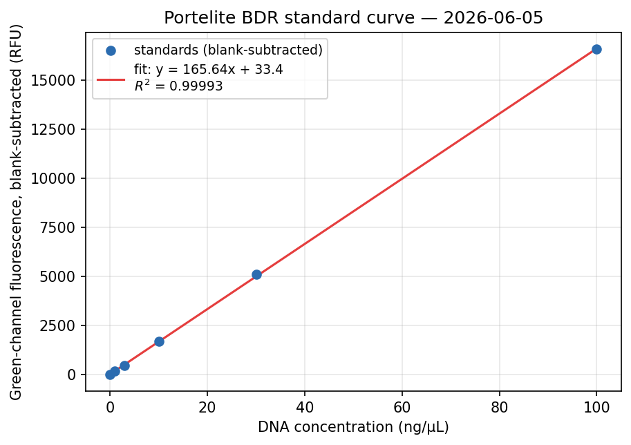
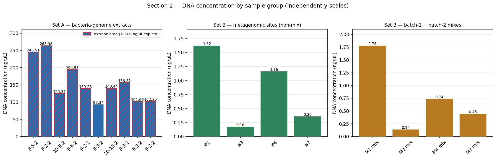
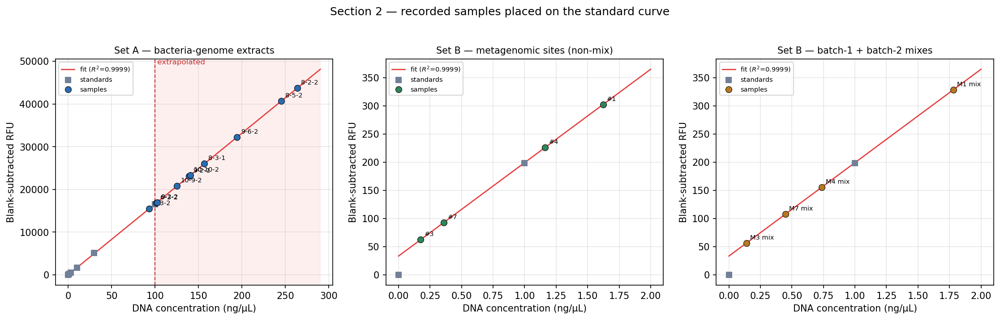

# Plaque Assay Round 3; Bacteria Genome Extraction; DNA Quantification

**Source pages:**   

**Roles today:**
- **Olivia** — media and plates (hard LB agar + soft LB agar for the plaque overlay).
- **Carol** — plaque assay, round 3 (layered-plate method).
- **Alex** — bacteria genome extraction (Quick-DNA Miniprep Kit, Zymo Research); Qubit quantification on (a) today's bacterial-genome extracts and (b) re-quant of the metagenomic 2nd-batch extracts from [2026-05-28](2026-05-28_inoculation-2nd-dna-extraction.md), including mixes of batch-1 + batch-2 paired samples.

## Objective
1. **Bacteria genome extraction** from the bacteria pellets banked on [2026-06-03](2026-06-03_phage-plaque-assay.md).
2. **DNA quantification** for both (a) today's bacteria-genome extracts and (b) the 2nd-batch metagenomic extracts from 5-28 (sites #1, #3, #4, #7), including mixes with the 1st batch.
3. **Phage plaque assay — round 3** using the layered-plate method (see [[plaque_assay_layered_plate]]).

## Procedure

### ① Media & plates (Olivia)

Two media prepared, both autoclaved.

| Use | Concentration | Per bottle | Bottles | Total | Per-bottle composition |
|---|---|---|---|---|---|
| Hard plates | **1 % LB agar** | **500 mL** | **2** | 1000 mL | 500 mL DI water + 12.5 g LB broth + 5 g agar |
| Plaque-assay soft overlay | **0.7 % LB agar** | **60 mL** | **2** | 120 mL | 60 mL DI water + 1.5 g LB broth + 0.42 g agar |

*Math check.* 1 % agar = 1 g / 100 mL → 5 g per 500 mL ✓. 0.7 % agar = 0.7 g / 100 mL → 0.42 g per 60 mL ✓. LB broth at the project-standard 25 g/L → 12.5 g per 500 mL ✓ and 1.5 g per 60 mL ✓.

*Capacity check.* Plaque assay below uses 3 mL of soft agar per plate × 30 plates = 90 mL needed. 2 × 60 mL = 120 mL prepared → 30 mL surplus, consistent with the [6-3 "make extra" lesson](2026-06-03_phage-plaque-assay.md).

Recipe reference: [[lb_agar]].

### ② Phage plaque assay — round 3 (Carol)

Standard layered-plate procedure (see [[plaque_assay_layered_plate]]):

- **30 plates total** = 3 phages × 10 bacteria.
- **Phages:** **ϕ8, ϕ9, ϕ10** (each across all 10 bacteria).
- **Bacteria:** the 10-stock panel reused from [2026-06-04](2026-06-04_second-phage-plaque-assay-prep.md). Bacteria include floc within the tube (might be dead bacteria), so we vortex to mix the bacteria well. 
- **Per plate (in falcon tube before pouring):** 3 mL of 0.7 % soft agar (50 °C water bath) + 300 µL actively-grown bacteria + 150 µL phage filtrate → poured onto a pre-solidified 1 % hard agar base, then 30 °C incubator, inverted. Increase the time of mixing bacteria and phage for better contact by vortexing. 
- Each plaque assay shall be done in four consecutive rounds, and this round is the 2nd effective round as the first round failed (we used PIA plates instead of regular LB plates as the hard layer).  

Outcome: **no plate failures observed during setup; readout tomorrow (2026-06-06).**

### ③ Bacteria genome extraction (Alex)

1. Took the **10 bacteria pellets** banked at **−20 °C** on [2026-06-03](2026-06-03_phage-plaque-assay.md). 6-3 pellet list as recorded: `9-2-2`, `10-9-2`, `8-5-2`, `8-3-2`, `9-2-1`, `6-3-2`, `8-2-2`, `10-10-2`, `8-5-2`, `9-6-2` (`8-5-2` duplicated). **Today's Set A table below records `8-3-2` × 2 and `8-5-2` × 1** — so either the 6-3 list mis-recorded which sample was duplicated, or one of today's tubes is mislabelled. `==CONFIRM: which is correct — does the freezer rack actually have two `8-3-2` pellets (and one `8-5-2`), or two `8-5-2` (and one `8-3-2`)?==`
2. Ran each through the **Quick-DNA Miniprep Kit (Zymo Research)** following the kit's manufacturer protocol.
   - Brief 10,000 g spin used at appropriate steps purely to consolidate solutions before transfer — not a separate procedural step.
3. Eluates retained for Qubit quantification (see ④).

### ④ Qubit DNA quantification (Alex)

Instrument: **Qubit 4 Fluorometer**, run in **raw fluorescence (RFU) mode** — *not* the built-in dsDNA quantitation assay. In this mode the instrument reports green-channel fluorescence (RFU) directly and does no concentration math, which is why all six standards were recorded and the standard curve is fit manually (see [`../../code/0605_quantification.ipynb`](../../code/0605_quantification.ipynb)). The BR dsDNA dye chemistry (Portelite, below) was still used. Reading displayed at 470 nm on the fluorescence page, as labelled on the instrument.

Two sets of samples quantified:

- **Set A — bacteria-genome extracts** (output of ③): 10 samples corresponding to the 10 pellets above.
- **Set B — metagenomic re-quant** of the 2nd-batch extracts from [2026-05-28](2026-05-28_inoculation-2nd-dna-extraction.md) (soil sites #1, #3, #4, #7), plus **mixes** of paired batch-1 + batch-2 samples (`M1 mix`, `M2 mix`, `M3 mix` on p.31) to test whether combining the two extraction batches gives a usable concentration.

Procedure: standard Qubit per [[dna_quantification_qubit]] — 190 µL working solution + 10 µL standard/sample = 200 µL per tube, vortex 2–3 s, incubate 2 min at room temp, read.

## Data — Qubit readings (from p.31)

> **Format note:** the data block on p.31 is dense and partially illegible at photo resolution. Sample-ID skeleton filled in below; **numerical values need to be transcribed directly from the page** — they're left as `[TBD: from p.31]` for you to fill in.

### Standards (calibration) — record before samples
*(Needed to draw the calibration curve. The Qubit reports concentration using its internal fit, but recording the raw fluorescence (RFU) of all six standards lets us reconstruct the standard curve and plot it.)*

**Kit:** **Portelite™ Fluorimetric DNA Quantitation Kit with Broad Dynamic Range** (AAT Bioquest, cat. **17665**) — see [`../../protocol/protocol-for-portelite-fluorimetric-dna-quantitation-kit-with-broad-dynamic-range-optimized-for-cytocite-and-qubit-fluorometers-version-OFFcC.pdf`](../../protocol/protocol-for-portelite-fluorimetric-dna-quantitation-kit-with-broad-dynamic-range-optimized-for-cytocite-and-qubit-fluorometers-version-OFFcC.pdf). Kit components:
- **A:** Helixyte™ Green **BR** (200X in DMSO) — Freeze
- **B:** Assay Buffer — Refrigerate 2–8 °C
- **C:** DNA Standard BR #1 — Calf thymus DNA, **0 ng/µL**
- **D:** DNA Standard BR #2 — Calf thymus DNA, **100 ng/µL**

The protocol's recommended calibration is a 1/3 serial dilution from Component D giving `30 / 10 / 3 / 1 / 0.3 / 0.1 / 0 ng/µL`. The team's 6-point series **uses Component D directly as the top standard** and a wider spacing:

| Standard      | Concentration (ng/µL) | How prepared                           | Fluorescence (RFU, green channel) |
| ------------- | --------------------- | -------------------------------------- | --------------------------------- |
| Std 0 (blank) | 0                     | Component C, undiluted                 | 127.59                            |
| Std 1         | 1                     | 1/3 serial dilution from Std 2         | 325.63                            |
| Std 3         | 3                     | 1/3 serial dilution from Std 3         | 606.82                            |
| Std 10        | 10                    | 1/3 serial dilution from Component D   | 1833.66                           |
| Std 30        | 30                    | 1/3 dilution from Component D (1:3.33) | 5229.49                           |
| Std 100       | 100                   | **Component D, undiluted**             | 16695.43                          |

**Instrument settings:** Excitation **480 nm**, emission **530 nm**, **green** fluorescence channel. (The "470 nm" Alex saw on the Qubit 4's fluorescence page is the instrument's display value for that channel — actual dye spectrum is 480 / 530.)

**Linear range (per kit):** the BDR assay is optimized for samples in the **0.2 → 100 ng/µL** range with the linear region of the standard curve covering roughly **10 pg/µL → 10 ng/µL**; above 10 ng/µL the RFU response is still monotonic but rolls off from linearity.

> **PI note (2026-06-05):** the curve can be **extrapolated a bit beyond the 100 ng/µL top standard** — the response stays well-behaved above 100 ng/µL within reason, so samples reading slightly above Std 5 can still be quoted from the extrapolated line rather than re-diluted, as long as they're not orders of magnitude above 100.

**Fit type:** the BDR kit's standard curve is fit by **linear regression** (RFU vs. concentration in ng/µL) — *not* the log-log fit used by the HS version. Subtract the Std 0 (blank) RFU from every other standard's RFU before fitting.

> **Suggested follow-up:** mirror the 5-29 pattern — save the full data (standards + Set A + Set B) into `data/0605_qubit.xlsx` so a Python script can fit the linear regression, report slope + intercept + R², and quote sample concentrations directly off the fit.

### Set A — bacteria-genome extracts

| Sample (bacteria stock) | Reading (RFU, green channel) |
| ----------------------- | --------------- |
| 8-5-2                   | 40827.88        |
| 8-2-2                   | 43887.14        |
| 10-9-2                  | 20917.70        |
| 9-6-2                   | 32384.09        |
| 9-2-1                   | 23232.52        |
| 8-3-2                   | 15622.18        |
| 10-10-2                 | 23423.31        |
| 8-3-2                   | 26136.76        |
| 6-3-2                   | 16999.92        |
| 9-2-2                   | 17097.18        |

### Set B — metagenomic 2nd-batch re-quant

| Sample (soil site) | Reading (RFU, green channel) |
| ------------------ | --------------- |
| #1                 | 429.84          |
| #3                 | 190.14          |
| #4                 | 353.60          |
| #7                 | 220.63          |

### Set B (continued) — Batch-1 + batch-2 mix samples

Each mix combines a 1st-batch metagenomic extract ([2026-05-20](2026-05-20_dna-extraction-soil-enrichment.md), sites #2, #5, #6, #8, #9, #10) with a 2nd-batch extract ([2026-05-28](2026-05-28_inoculation-2nd-dna-extraction.md), sites #1, #3, #4, #7), to see if combining recovers a measurable concentration (m stands for metagenomic in the table below).

| Mix    | Reading (RFU, green channel) |
| ------ | --------------- |
| M1 mix | 455.83          |
| M3 mix | 184.11          |
| M4 mix | 283.19          |
| M7 mix | 235.20          |

**Outcome.** Metagenomic re-quant concentrations were still **low** across all four 2nd-batch samples (and across the mixes). The conclusion is that **another round of metagenomic extraction is needed** — see Lessons below.

### Volume left in tubes after Qubit (margin notes, p.31)
- **Metagenomic samples:** ~ **80 µL** left in each tube after aliquoting for Qubit.
- **Bacterial samples:** ~ **90 µL** left in each tube after aliquoting for Qubit.

### Storage (margin arrow diagram, p.31)
- **All samples → 4 °C fridge** (working stocks of both bacterial-genome and metagenomic extracts).
- *(No −80 °C archive split on this batch; the entire eluate volume stays at 4 °C for now since concentrations are low enough that the team may need to re-process rather than aliquot.)*

## Computed concentrations & masses

Derived from the Standards and sample-RFU tables above by inverting the linear standard curve in [`../../code/0605_quantification.ipynb`](../../code/0605_quantification.ipynb). All values reproducible by re-running that notebook against the (raw RFU, standards) tables in this file.

### Standard-curve fit (Section 1 of the notebook)

- Linear regression of blank-subtracted RFU vs. concentration (ng/µL).
- Blank (Std 0) RFU = **127.59**
- Slope = **165.6425** RFU per ng/µL
- Intercept = **33.4265** RFU
- **R² = 0.999929** (6-point fit, 0–100 ng/µL)
- Top standard = 100 ng/µL → readings whose computed concentration exceeds this are extrapolated per PI guidance.

### Set A — bacteria-genome extracts

Computed against the 90 µL remaining-volume estimate (p.31 margin). 9 of 10 samples land **above the 100 ng/µL top standard** and are quoted by extrapolation (⚠).

| Sample | RFU | Conc (ng/µL) | Mass in 90 µL tube (µg) | Extrapolated? |
|---|---:|---:|---:|---|
| 8-5-2  | 40,827.88 | 245.51 | 22.10 | ⚠ |
| 8-2-2  | 43,887.14 | 263.98 | 23.76 | ⚠ |
| 10-9-2 | 20,917.70 | 125.31 | 11.28 | ⚠ |
| 9-6-2  | 32,384.09 | 194.53 | 17.51 | ⚠ |
| 9-2-1  | 23,232.52 | 139.29 | 12.54 | ⚠ |
| 8-3-2 (a) | 15,622.18 |  93.34 |  8.40 |   |
| 10-10-2| 23,423.31 | 140.44 | 12.64 | ⚠ |
| 8-3-2 (b) | 26,136.76 | 156.82 | 14.11 | ⚠ |
| 6-3-2  | 16,999.92 | 101.66 |  9.15 | ⚠ |
| 9-2-2  | 17,097.18 | 102.25 |  9.20 | ⚠ |

> The two `8-3-2` rows reflect today's actual Set A composition (see the `==CONFIRM==` flag in Procedure ③ about the 6-3 pellet-list mismatch). `(a)` and `(b)` are added only to disambiguate them in this table.

**Set A total recoverable DNA: ≈ 140.68 µg** across 10 tubes (range 8.4–23.8 µg per tube). The single in-range sample (`8-3-2 (a)` at 93.3 ng/µL) sits right at the kit's well-characterised linear-region ceiling (10 ng/µL nominal, but in practice tracks linearly close to Std 100 too — see the standard-curve plot's R²).

### Set B — metagenomic 2nd-batch sites + batch-1 + batch-2 mixes

Computed against the 80 µL remaining-volume estimate (p.31 margin). All samples are well within the linear range.

| Sample |    RFU | Conc (ng/µL) | Mass in 80 µL tube (µg) |
| ------ | -----: | -----------: | ----------------------: |
| #1     | 429.84 |         1.62 |                   0.130 |
| #3     | 190.14 |         0.18 |                   0.015 |
| #4     | 353.60 |         1.16 |                   0.093 |
| #7     | 220.63 |         0.36 |                   0.029 |
| M1 mix | 455.83 |         1.78 |                   0.142 |
| M3 mix | 184.11 |         0.14 |                   0.011 |
| M4 mix | 283.19 |         0.74 |                   0.059 |
| M7 mix | 235.20 |         0.45 |                   0.036 |

**Set B totals:** ≈ **0.27 µg** across the 4 non-mix sites + ≈ **0.25 µg** across the 4 mixes (≈ 0.51 µg combined). Highest single sample is `M1 mix` at 1.78 ng/µL — still ~50× below the lowest bacterial sample. This is what drives the small-biomass re-extraction plan (see Lessons).

### Plots — concentration per sample group

Bar charts on **independent y-scales** (bacterial reads are ~100× higher than metagenomic, so a shared scale would flatten Set B to invisibility). Hatched red-edged bars are extrapolated above 100 ng/µL.

### Plots — samples on the standard curve

Each sample placed on the fitted line at its (concentration, blank-subtracted RFU) coordinate. The pink-shaded band in the Set A panel marks the extrapolated region beyond the 100 ng/µL top standard.

## Lessons / planning notes

- **Plaque assay R3** → no failures during plating; readout tomorrow (2026-06-06).
- **Metagenomic concentrations remain low.** PI's recommendation is to redo metagenomic extraction with **smaller biomass per tube** (less soil per extraction): the rationale is that the kit's silica column has a finite binding capacity and over-loading soil can saturate the column with co-extracted inhibitors / particulates that compete with DNA binding. Plan: **4 more metagenomic extraction trials with smaller per-sample soil mass** (`[TBD: target mass per tube — possibly down to ~12.5 mg from the standard 1 g, but the page is ambiguous; confirm.]`).
- The `M1/M2/M3 mix` experiment was a one-shot try at recovering signal by combining 1st and 2nd batches; if the readings are below threshold, the path forward is the smaller-biomass re-extraction above rather than further mixing.
- **Bacterial-genome track is in good shape for sequencing.** Every Set A isolate ≥ 93 ng/µL (well above the typical ≥ 10 ng/µL submission floor); per-tube masses 8.4–23.8 µg. Mixes and metagenomic 2nd-batch samples sit ≈ 35–500× below the lowest bacterial sample — the gap is a single-step problem (extraction yield), not the kit chemistry.

---
## Log
- 2026-06-05 — Initial digitization from `lab_notebook/0605/IMG_4256.png` → `p29.png`, `IMG_4257.png` → `p30.png`, `IMG_4258.png` → `p31.png`.
- 2026-06-05 — Rewrote with user clarifications: corrected ① to 2 × 500 mL hard + 2 × 60 mL soft (volume math verified); confirmed ϕ8/9/10 for plaque R3; recorded Quick-DNA Miniprep Kit (Zymo); reframed Set B as bacterial extracts + metagenomic re-quant (with M1/M2/M3 batch-1 + batch-2 mixes); recorded "all samples → 4 °C" storage; added the small-biomass re-extraction plan to Lessons. Numerical Qubit readings still need to be transcribed off p.31 — flagged as `[TBD]` in each data row.
- 2026-06-05 — Added a **Standards (calibration)** table above the sample sets so the Qubit standard-curve data is captured for graphing. Noted the suggested `data/0605_qubit.xlsx` mirror of the 5-29 pattern.
- 2026-06-05 — Corrected kit identity: it is the **Portelite Broad Dynamic Range** kit (cat. 17665, Helixyte Green BR, Component D = 100 ng/µL — NOT the High-Sensitivity variant 17660/17661). Updated the standards table accordingly (Std 5 = 100 ng/µL prepared from Component D undiluted; protocol's own recommended series noted as alternative). Updated fit type to linear regression (not log-log) and instrument ex/em to 480 / 530 nm.
- 2026-06-05 — Clarified that the Qubit was run in **raw fluorescence (RFU) mode**, not the built-in dsDNA assay (Alex confirmed) — so the instrument output raw green-channel fluorescence, not concentration. Corrected the instrument line in ④ accordingly and relabeled the three sample-table value columns "Reading (ng/µL)" → **"Reading (RFU, green channel)"** to match. Processing notebook [`../../code/0605_quantification.ipynb`](../../code/0605_quantification.ipynb) builds the standard curve (linear fit, slope 165.64, intercept 33.43, R² 0.99993), converts each reading to concentration, and computes per-tube mass from the 90 µL / 80 µL remaining volumes.
- 2026-06-05 — Fixed transcription: Set A sample `8-3-1` (RFU 26136.76) corrected to `8-3-2` per user — same fix applied to `code/0605_quantification.ipynb` cell `f90e9794`. Side-effect: today's Set A now records `8-3-2` × 2 and `8-5-2` × 1, which **does not match** the 6-3 pellet list (which had `8-5-2` × 2 and `8-3-2` × 1) — flagged inline in Procedure ③ as `==CONFIRM==` for the team to verify against the physical freezer rack.
- 2026-06-05 — Added a new **`## Computed concentrations & masses`** section between the raw-RFU Data section and the Lessons section. Derived from the standard-curve fit in [`../../code/0605_quantification.ipynb`](../../code/0605_quantification.ipynb). Contains: standard-curve fit summary (R² 0.999929), Set A concentration + per-tube mass table (9 of 10 extrapolated above 100 ng/µL), Set B sites + mixes table (all within linear range), and the three plots from `code/output/`. Headline: Set A total ≈ 140.7 µg recoverable bacterial DNA; Set B sites + mixes total ≈ 0.51 µg combined. Appended one bullet to Lessons noting that the bacterial-genome track is in good shape for sequencing (≥ 93 ng/µL on every isolate).
