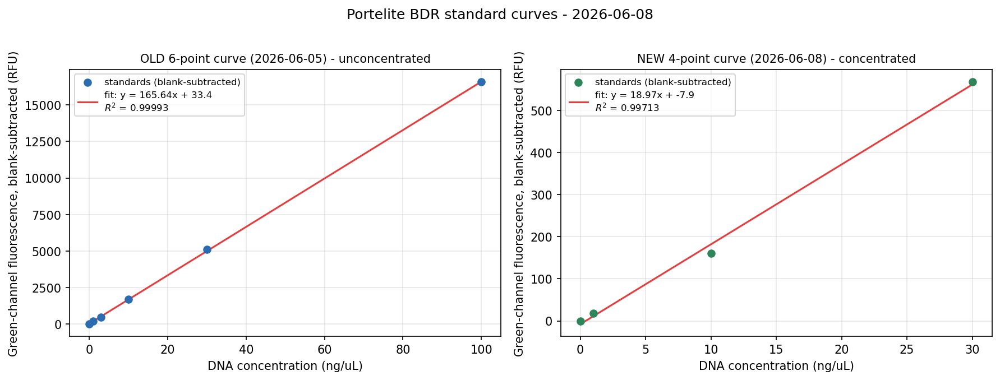
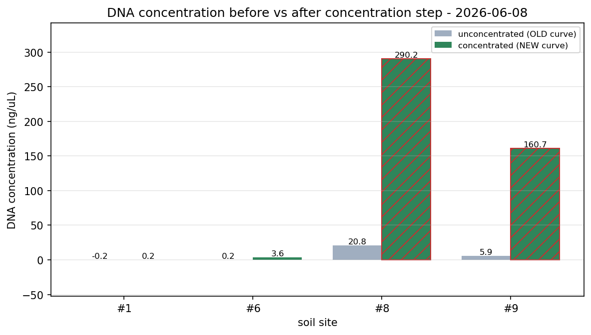
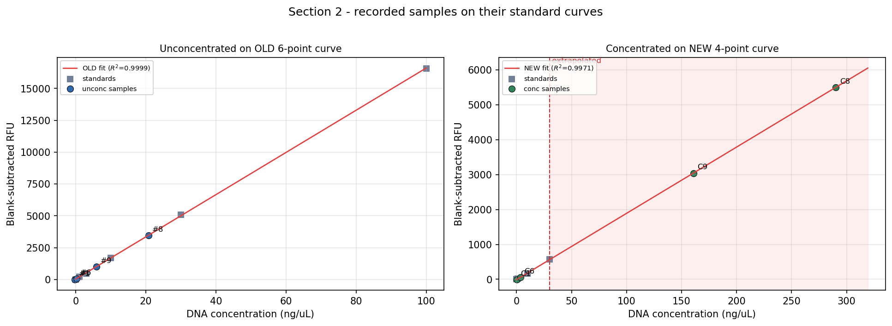

# LB Broth Prep; Revive/Plate Bacteria; Soil Enrichment; Metagenomic Extraction; DNA Concentration; Qubit Quantification; Sequencing Submission

**Source pages:**     

**Kit-protocol photo (not a notebook page):** the printed DNA-purification page used for the metagenomic extraction (with run annotations) is `../0608/IMG_4411.png` — transcribed into [[metagenomic_dna_extraction]].

## Objective (p32)
1. **Prepare LB broth** for upcoming work (`[TBD: volume — p32 reads "copy size mL × 1"; confirm, likely 200–500 mL × 1]`).
2. **Plate / revive bacteria** — one plate per prepared bacterial stock, from the −80 °C glycerol stocks, for later plate use (see [[revive_bacteria_from_glycerol_stock]]).
3. **Soil enrichment (phage)** — 1 g soil + LB broth per flask, one flask per site (follow the protocols listed from [2026-06-01](2026-06-01_lb-agar-phage-buffer.md); see [[soil_enrichment_phage]]). **Sites #3, 5, 6, 8, 9, 10** (confirmed — same as the 6-1 phage enrichment; this batch is isolated to filtrate on [2026-06-09](2026-06-09_bacteria-culture-phage-isolation.md)).
4. **Metagenomic DNA extraction** ("DNA extract with growth", per p32 title) on soil sites **#1, #6, #8, #9**, then **concentrate** the eluate.
5. **DNA quantification** of the extracts — both **unconcentrated** and **concentrated**.

> [!note] Page p32–p33 legibility
> The p32 objective/procedure list and the p33 setup sketches (bead-beater / vortex "manual mode" diagram + a standard-curve sketch) are partly illegible at photo resolution. The objective above captures the readable intent; sub-step wording is `[TBD]` where noted. The actual run details are recorded against the dedicated protocols below.

## Procedure

### ① Revive / plate bacteria (p32, p34)
- Streaked the banked −80 °C glycerol stocks onto fresh LB agar plates (one plate per stock), three-phase streak — see [[revive_bacteria_from_glycerol_stock]] and [[three_phase_streak]].
- **Bacteria stocks used (p34) — 10 stocks.** OD column is each stock's raw-culture A₆₀₀ from the [2026-05-29](2026-05-29_optical-density-bacteria-stock.md) measurement (Sheet 2), recorded when these were banked — no fresh OD was taken on 6-8:

| Stock | OD₆₀₀ (A₆₀₀, from 5-29) |
|---|---:|
| 6-10-2 | 0.766 |
| 6-2-1 | 0.826 |
| 9-9-2 | 1.498 |
| 8-10-2 | 0.934 |
| 9-10-1 | 1.554 |
| 8-1-2 | 1.176 |
| 6-8-1 | 1.175 |
| 6-8-2 | 0.848 |
| 9-1-1 | 1.671 |
| 9-1-2 | 1.224 |

  **All 10 are likely *P. aeruginosa* candidates** — they all come from the 5-29 stock-list bottom block (entries 14–28), which the team considers the likely *P. aeruginosa* set (the "Most Likely *P. aeruginosa*" note on 6-2-1 heads that whole block, not just that one stock). So this revived panel *is* the *P. aeruginosa* candidate set. All are ≥ 0.6 (the 5-29 stock-taking threshold). `[TBD: if a fresh OD was read on 6-8, it is not on these pages — add it if so.]`
- **Storage (p34):** plates → **30 °C incubator**; stocks → back to **−80 °C freezer**.

### ② Plaque-plate selection note (p34)
- For the plaque assays already running (plates poured from [2026-06-03](2026-06-03_phage-plaque-assay.md) onward), the team will **pick 5 of the 10 bacteria** for downstream plate work. `[TBD: selection criteria — p34 reads "image by pic level", "12–13 cm distance", "#1 KH, m 6×4"; meaning unclear, confirm.]`

### ③ LB broth + soil enrichment (p32)
- LB broth prepared per [[lb_broth]] (`[TBD]` volume).
- **Phage** soil enrichment set up per the 6-01 protocol ([[soil_enrichment_phage]]): 1 g soil + LB broth per flask, **sites #3, 5, 6, 8, 9, 10** (6 flasks). Isolated to phage filtrate the next day — see [2026-06-09](2026-06-09_bacteria-culture-phage-isolation.md) ②.

### ④ Metagenomic DNA extraction — reduced biomass + pooling (p32 title "with growth"; kit page IMG_4411)
Ran the kit DNA-purification protocol (see [[metagenomic_dna_extraction]] for the full 13-step transcription) on soil sites **#1, #6, #8, #9**. Run parameters recorded as annotations on the kit page:
- **Input mass: 0.12 g (120 mg) per BashingBead lysis tube** (confirmed — the lab scale has no mg mode, so the value is in g). This is the **small-biomass fix** for the 0605 column-saturation problem: the team's earlier metagenomic runs loaded ~**1 g/tube**, which over-saturated the silica column; 0.12 g/tube is an **~8× per-tube reduction**, landing near the kit's 150 mg spec. Four such tubes are then pooled per site (step 13) to recover total DNA mass.
- **Bead-beating: 40 min on the vortex, level 3 (max level)** — in place of the kit's recommended ≥ 5 min dedicated bead-beater.
- Lysis-tube spin **10,000 × g, 1 min**; supernatant → Zymo-Spin III-F filter; + Genomic Lysis Buffer; load Zymo-Spin IICR column **800 µL ×2**; Pre-Wash; g-DNA Wash; **elute 100 µL**; pass through Zymo-Spin **IV-HRC** inhibitor-removal filter (8,000 × g).
- **Pooling (step 13): "mix 4 tubes into 1"** — four parallel lysis-tube extractions pooled per sample to recover enough DNA. `[TBD: exact pooling ratio — annotation reads "1-1, 1, 1×1".]`

This is the **small-biomass + pooling** corrective the 0605 low-yield result called for: drop the per-tube soil load (1 g → 0.12 g) so the silica column isn't saturated, then pool 4 tubes per site to make up DNA mass. See [[metagenomic_dna_extraction]] project record.

### ⑤ DNA concentration / cleanup (p35)
Pooled eluates were concentrated/cleaned on a spin column before quantification — see [[dna_concentration]] for the full protocol. As recorded on p35:
- Transferred the eluate **1.5 mL at a time** into a 2 mL tube (`[TBD]`: p35 reads "transfer from ~7.5 mL eppendorf to 2 mL"; volume unclear), processed in **batches of 4–5**.
- Loaded DNA onto the column; added **binding buffer at 3 : 1**; centrifuged, re-passing the flow-through through the filter and spinning again, **repeating at least once** so DNA stays bound; repeated for all the solution across both source tubes.
- **500 µL g-DNA Wash Buffer → 10,000 × g, 1 min**, discard flow-through.
- **DNA Elution Buffer → 10,000 × g, 3 min** into a 1.5 mL tube.
- → quantified the eluate (⑥).

### ⑥ Qubit quantification — before vs after concentration (p34, p36)
Same Portelite BDR chemistry on the Qubit (raw-RFU mode) as [2026-06-05](2026-06-05_plaque-assay-r3-dna-extraction-quantification.md); see [[dna_quantification_qubit]]. Tube setup per p34: **190 µL working solution + 10 µL sample = 200 µL**.

Each of sites **#1, #6, #8, #9** was read **twice**:
- **Unconcentrated** — "quantification continued **with last week's standards**" (the 0605 6-point curve), 4 samples (p34).
- **Concentrated** — read against a **new standard curve recreated with smaller volume** this session (p36).

## Data — Qubit readings

> **Transcription note.** p36 is dense; several digits are ambiguous at photo resolution and are flagged inline. The user's started `code/0608_quantification.ipynb` had begun transcribing these and carried a few errors (e.g. `C1` had been filled with the Std-10 value `316.95`) — corrected here against the page.

### Unconcentrated set — read against last week's (0605) 6-point curve
Curve reused verbatim from [2026-06-05](2026-06-05_plaque-assay-r3-dna-extraction-quantification.md):

| Standard | Conc (ng/µL) | RFU (green) |
|---|---:|---:|
| Std 0 (blank) | 0 | 127.59 |
| Std 1 | 1 | 325.63 |
| Std 3 | 3 | 606.82 |
| Std 10 | 10 | 1833.66 |
| Std 30 | 30 | 5229.49 |
| Std 100 | 100 | 16695.43 |

| Sample (soil site) | Reading (RFU, green) |
|---|---:|
| #1 | 119.87 |
| #6 | 195.94 |
| #8 | 3600.46 |
| #9 | 1139.16 |

*(These are the readings the p.35-top block "360 / 1129 …" was a partial/garbled transcription of; resolved against the bench record. #1 reads below the Std-0 blank (127.59) → ≈ 0 ng/µL.)*

### Concentrated set — read against the new (smaller-volume) 4-point curve (p36)

| Standard | team label | Conc (ng/µL) | RFU (green) |
|---|---|---:|---:|
| Std 0 (blank) | S0 | 0 | 156.326 `[TBD: photo "15 6326"; started nb read 156.26]` |
| Std 1 | S1 | 1 | 173.90 `[TBD: started nb read 173.70]` |
| Std 10 | S10 | 10 | 316.95 |
| Std 30 | S30 | 30 | 724.52 `[TBD: p36 subscript reads like "S₅₀" and value like "7224.52"; resolved with team to Std 30 = 724.52 on linearity grounds — a conc-50 point would be a ~10× outlier off the line.]` |

| Sample (concentrated site) | Reading (RFU, green) |
|---|---:|
| C1 (site #1) | 151.67 `[TBD: photo "151.6x" — last digit unclear]` |
| C6 (site #6) | 216.38 |
| C8 (site #8) | 5655.31 `[TBD: photo "5655.31" vs "5455.31"]` |
| C9 (site #9) | 3197.36 `[TBD: photo last digits ".36" vs ".86"]` |

### Margin calc (p36, right) — concentration factor
Scratch arithmetic for the fold-concentration / final-volume, partly legible: `≈ 250 ng/µL`, `× 30`, `→ ≈ 180 ng/µL` and `≈ 16k ng/µL → 30 µL` style notes. `[TBD: transcribe the concentration-factor calc exactly — the team appears to have concentrated into ~30 µL. Confirm the eluate volume and the ×30 factor.]`

## Computed concentrations & masses
Processed in [`../../code/0608_quantification.ipynb`](../../code/0608_quantification.ipynb): the **unconcentrated** readings are inverted against the **0605 6-point curve**, the **concentrated** readings against the **new 4-point curve**, then a before/after comparison (fold-change) and per-tube mass are computed.

**Before vs after concentration** (computed in the notebook):

| Site | Unconc RFU | Unconc conc (ng/µL) | Conc RFU | Conc conc (ng/µL) | Fold-change |
|---|---:|---:|---:|---:|---:|
| #1 | 119.87 | ≈ 0 (below blank) | 151.67 | ≈ 0 (below blank) | — |
| #6 | 195.94 | 0.21 | 216.38 | 3.58 | ~17× |
| #8 | 3600.46 | 20.76 | 5655.31 | 290.23 ⚠ | ~14× |
| #9 | 1139.16 | 5.91 | 3197.36 | 160.69 ⚠ | ~27× |

⚠ = concentrated value extrapolated above the new curve's Std 30 top point.

## Sequencing submission (2026-06-08)
Sent five genomes for sequencing today:
- **Metagenomes:** sites **#8** and **#9** — the concentrated DNA from ⑤/⑥ (C8, C9).
- **Bacterial genomes:** **9-2-1**, **9-6-2**, **10-10-2** — extracted on [2026-06-05](2026-06-05_plaque-assay-r3-dna-extraction-quantification.md) (Set A); concentrations from that day's [`0605_quantification.ipynb`](../../code/0605_quantification.ipynb).

**Prep before submission** (the two sample types were handled differently):
- **Metagenomes (#8, #9) — diluted:** **50 µL kit buffer added to 38 µL DNA → 88 µL** (factor 38/88 = 0.432). The 38 µL is the concentration-process eluate: **40 µL curated, 2 µL taken for quantification, 38 µL is the rest.**
- **Bacterial genomes (9-2-1, 9-6-2, 10-10-2) — NOT diluted:** submitted at their [2026-06-05](2026-06-05_plaque-assay-r3-dna-extraction-quantification.md) extraction concentration; volume per that day's bacteria-extraction record (≈ **90 µL** eluate remaining).
  > ⚠ **Contradicted 2026-08-08 — see the Log.** Alex states the bacterial DNA *was* normalised to **50 ng/µL** before submission and that ~20 µL was sent, matching the MRA manuscript's methods. Both accounts are kept here rather than one overwriting the other; the table below records the undiluted reading as originally transcribed.

Computed in [`../../code/0608_quantification.ipynb`](../../code/0608_quantification.ipynb) (Section 4):

| Sample | Type | Diluted? | Original conc (ng/µL) | Submitted conc (ng/µL) | Volume (µL) | DNA mass submitted (µg) |
|---|---|---|---:|---:|---:|---:|
| Metagenome site #8 | metagenome | yes (38 + 50) | 290.23 ⚠ | 125.33 | 88 | 11.03 |
| Metagenome site #9 | metagenome | yes (38 + 50) | 160.69 ⚠ | 69.39 | 88 | 6.11 |
| 9-2-1 | bacterial genome | no | 139.29 ⚠ | 139.29 | ≈ 90 | 12.54 |
| 9-6-2 | bacterial genome | no | 194.53 ⚠ | 194.53 | ≈ 90 | 17.51 |
| 10-10-2 | bacterial genome | no | 140.44 ⚠ | 140.44 | ≈ 90 | 12.64 |

⚠ = original concentration is **extrapolated** above its standard curve's top point (metagenomes #8/#9 above the new Std 30; the three bacterial genomes above the 0605 Std 100) — the submitted values carry that uncertainty.

> [!note] Flags
> - Metagenome mass submitted = original conc × 38 µL (dilution changes concentration/volume, not DNA mass). Bacterial mass = original conc × ≈ 90 µL (the 6-5 remaining volume; bacterial masses match the 6-5 computed values).
> - `[TBD]` Bacterial **submitted volume** taken as ≈ 90 µL from the [2026-06-05](2026-06-05_plaque-assay-r3-dna-extraction-quantification.md) margin — confirm the actual volume sent if less than the full eluate.

## Lessons / planning notes
- **Small-biomass (1 g → 0.12 g/tube) + pooling (4 tubes/site) + concentration** is the corrective path for the persistent low metagenomic yield (0527 / 0605), reducing per-tube column loading while pooling to keep total DNA mass up.
- **Concentrated readings span a wide range** — C8 (5655 RFU) and C9 (3197 RFU) are far above the new curve's top standard (Std 30) and are heavily extrapolated; C1 and C6 sit near the low standards. Interpret C8/C9 with caution (extrapolated) and confirm whether they need re-dilution against a higher standard.
- ⚠ **Site #1 reads *below* the blank on both curves** — unconc 119.87 < OLD blank 127.59, and conc C1 151.67 < NEW blank 156.33 → ≈ 0 ng/µL before and after. Consistent with site #1 simply having no recoverable DNA. `[TBD: confirm — or a transcription slip on C1 / S0?]`
- **Outcome — the concentration step worked.** Sites **#6 (~17×), #8 (~14×), #9 (~27×)** were lifted from ~0.2–21 ng/µL (unconcentrated) into a measurable range (3.6–290 ng/µL). Site **#1 stayed ≈ 0** (no DNA). This validates the small-biomass + pooling + concentrate workflow for low-yield soil metagenomes.

---
## Log
- 2026-06-08 — Initial digitization from `lab_notebook/0608/IMG_4416.png`→`p32.png` … `IMG_4420.png`→`p36.png`. Printed kit page `IMG_4411.png` transcribed into [[metagenomic_dna_extraction]] (not a notebook page). Concentrated-set standards (S0/S1/S10/S30) and samples (C1/C6/C8/C9) transcribed from p36; the metagenomic run params (40 min vortex L3, 4-tubes-pooled) and the DNA-concentration steps from IMG_4411/p35 captured against the protocols. **Open `[TBD]`s:** the four unconcentrated #1/6/8/9 RFU readings (not legibly on p34/p35); the **per-tube input mass (0.12 g vs 12.5 mg — ~10× ambiguity that decides whether this is genuinely "small-biomass")**; several blurry digits on p36 (S0, S1, C1, C8, C9); the p36 concentration-factor calc; and the p32/p33 objective sub-steps. Did **not** assert "small-biomass" as settled — flagged the mass as the discriminating number.
- 2026-06-08 — Added the **Sequencing submission** section (5 genomes: metagenomes #8/#9 + bacterial 9-2-1/9-6-2/10-10-2; diluted 38 µL DNA + 50 µL kit buffer → 88 µL). Dilution + submitted-mass computed in `code/0608_quantification.ipynb` Section 4 (metagenome concs from this notebook, bacterial concs from `0605_quantification.ipynb`). `[TBD]` whether the bacterial extracts used the same 38 µL input (theirs came from the ~90 µL 6-5 eluate).
- 2026-06-09 — **Phage soil-enrichment (③) confirmed (user):** sites **#3, 5, 6, 8, 9, 10** (same as the 6-1 phage enrichment). Corrected the protocol reference [[soil_enrichment_bacteria]] → [[soil_enrichment_phage]] (LB-based, phage track) and resolved the `[TBD]` site list. This batch is isolated to filtrate on 6-9.
- 2026-06-08 — **Bacteria stocks (p34) confirmed (user):** 10 stocks — 6-10-2, 6-2-1, 9-9-2, 8-10-2, 9-10-1, 8-1-2, 6-8-1, 6-8-2, 9-1-1, 9-1-2 (replaces the earlier illegible-list guess, which was wrong — these are *not* the 6-01 revival set). Added an **OD₆₀₀ column** from the [2026-05-29](2026-05-29_optical-density-bacteria-stock.md) Sheet-2 raw-culture A₆₀₀ values. **All 10 are likely *P. aeruginosa* candidates** (user) — they're all in the 5-29 stock-list bottom block (entries 14–28); the "Most Likely *P. aeruginosa*" note heads that whole block, not just 6-2-1. Clarified the 5-29 entry accordingly.
- 2026-08-08 — ⚠ **The "bacterial genomes NOT diluted" record is contradicted by Alex and should not be relied on.** While preparing the MRA00793-26 revision, the manuscript's methods sentence — *"DNA was quantified using Portlite Fluorimetric DNA Quantification Kit (AAT Bioquest) and renormalized to 50 ng/uL. 20 uL were sent out for sequencing"* — was checked against this entry, which says the opposite. **Alex confirms the manuscript is correct: the bacterial genomic DNA was normalised to 50 ng/µL and ~20 µL was submitted; the dilution step simply never got written down.** That makes the entry below (and the "Submitted conc" column of the table above, and `data/dna_extraction_inventory.md:116-128`) wrong on this point.
  Both accounts are left in place rather than one being deleted, per the project convention of keeping disagreeing sources side by side. Two things support the corrected version: the submitted **volume was already flagged `[TBD]`** in this entry ("confirm the actual volume sent if less than the full eluate"), so the ≈ 90 µL figure was inferred rather than recorded; and 50 ng/µL × 20 µL = 1 µg, a normal submission mass, whereas the undiluted reading implies 12.5–17.5 µg. **Anyone citing submission concentrations from this day should use 50 ng/µL, not the 139.29 / 194.53 / 140.44 values.** Note also that this entry only ever covered 9-2-1, 9-6-2 and 10-10-2 — **8-5-2 and 8-10-2, two of the three isolates in the MRA, have no submission record here at all.**
- 2026-06-08 — **Resolved three opens (user-confirmed):** (1) the four **unconcentrated #1/6/8/9 RFU readings** = **119.87 / 195.94 / 3600.46 / 1139.16** — filled into the data table, the before/after table, and the notebook; before/after fold-change now computed (#6 ~17×, #8 ~14×, #9 ~27×; #1 ≈ 0 both, below blank). (2) **Input mass = 0.12 g/tube confirmed** (scale has no mg mode) — reframed as the small-biomass fix (1 g → 0.12 g/tube, ~8× per-tube reduction) + 4-tube pooling; dropped the 12.5 mg alternative and the `[TBD]`. (3) **Bacterial genomes were NOT diluted** — submitted at their 6-5 extraction concentration, volume ≈ 90 µL per the 6-5 record; sequencing table split into diluted (metagenome) vs undiluted (bacterial). Notebook rebuilt + re-executed clean. Corrected the started notebook's `C1 = 316.95` (that is the Std-10 value).
