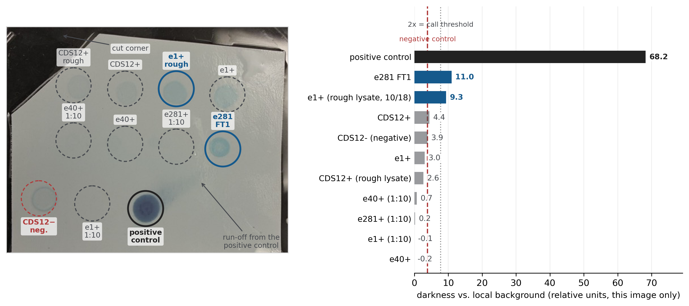

# His-tag Dot Blot — e281 Flow-Through and e1 Lysate Are the Only Positives

**Source images:**
[`data/assays/1019_dotblot/dotblot.jpeg`](../../data/assays/1019_dotblot/dotblot.jpeg) (developed
membrane) ·
[`data/assays/1019_dotblot/dotblot_label.jpeg`](../../data/assays/1019_dotblot/dotblot_label.jpeg)
(the hand-drawn layout sheet)

> [!note] No notebook page
> There is **no written notebook page for this day**. The record is the loose layout sheet
> photographed alongside the membrane, plus the membrane photograph itself. This is the first
> entry in the digitized set with no `nb` page behind it.
> `==CONFIRM: whether this was also written into notebook 2 (p.09+), which has never been photographed.==`

## What was done

A **dot blot** against the His tag, spotting eleven samples directly onto membrane — no gel, no
size separation. This is the first His-tag detection of the project that does not depend on
reading a band position off a gel.

- **Blocking:** PBS + Blotting-Grade Blocker, **1 h** incubation.
  `==CONFIRM: the blocker mass and percentage. The sheet's reverse reads "4.25 g" and "0.05"/"20.0" through the paper, mirrored and faint — not reliably legible.==`
- **Detection:** a **single-step anti-His HRP conjugate** (no separate primary and secondary),
  developed with a **pale brown** substrate solution giving a blue product (per Alex, 2026-10-19).
  `==CONFIRM: the conjugate and substrate product names and catalogue numbers. With HRP, a pale substrate developing to blue points to precipitating TMB or 4-chloro-1-naphthol — it is specifically not BCIP/NBT, which needs alkaline phosphatase. Which of the two was used is not recorded.==`
- **Samples:** rough lysates from **10/18**, plus the **1:10 dilutions prepared for the 10/16
  spot test**, plus one `e281` **flow-through** fraction.
  `==CONFIRM: spotting volume per dot — not recorded.==`

## Layout

Eleven spots, **4 + 4 + 3**, read in the orientation of the photograph (cut corner top-left;
confirmed by Alex that the photograph and the layout sheet share an orientation). Row 3 sits
about 45 px left of rows 1–2 and carries three samples, the last drawn on the sheet as a wide
oval.

|  | col 1 | col 2 | col 3 | col 4 |
|---|---|---|---|---|
| **row 1** | CDS12+ (rough lysate) | CDS12+ | e1+ (rough lysate, 10/18) | e1+ |
| **row 2** | e40+ (1:10) | e40+ | e281+ (1:10) | **e281 FT1** |
| **row 3** | CDS12− (negative) | e1+ (1:10) | **positive control** (wide) | — |

- `CDS12−` is the negative control, taken **"from the white rack"** per the sheet.
- `e281 FT1` = the **flow-through**, fraction 1. `==CONFIRM: that FT1 means flow-through fraction 1, and which purification run it came from — presumably 10/10.==`
- The **positive control was borrowed from a neighbouring lab and its identity is not known to
  us** (Alex, 2026-10-19). It therefore validates that the detection chemistry worked, but gives
  **no quantitative anchor** and cannot be used as a loading reference.

## Result

Measured with [`code/1019_dotblot/quantify_dotblot.py`](../../code/1019_dotblot/quantify_dotblot.py)
→ [`code/output/1019_dotblot/spot_intensities.tsv`](../../code/output/1019_dotblot/spot_intensities.tsv);
annotated by [`annotate_dotblot.py`](../../code/1019_dotblot/annotate_dotblot.py).

"Darkness" is how much darker the 18 px disc at each spot is than its own local background
annulus, so the values are **relative to this one image** — there is no ladder and no standard.
A spot is only **called** if it reaches **2× the negative control**; `CDS12+` lands at 1.1× and is
therefore inside the noise, not a result.

| spot | darkness | vs. negative | call |
|---|---|---|---|
| **positive control** | **68.2** | 17.7× | strong — chemistry worked |
| **e281 FT1** | **11.0** | **2.9×** | **positive** |
| **e1+ (rough lysate, 10/18)** | **9.3** | **2.4×** | **positive** |
| CDS12+ | 4.4 | 1.1× | inside the noise — no call |
| *CDS12− (negative)* | *3.9* | — | *the noise floor — a hollow drying ring* |
| e1+ | 3.0 | 0.8× | below the negative |
| CDS12+ (rough lysate) | 2.6 | 0.7× | below the negative |
| e40+ (1:10) | 0.7 | 0.2× | nothing there |
| e281+ (1:10) | 0.2 | 0.1× | nothing there |
| e1+ (1:10) | −0.1 | — | nothing there |
| e40+ | −0.2 | — | nothing there |

**Three things this says.**

1. **The assay is valid.** The positive control is ~18× the negative and six times the strongest
   sample, so the anti-His HRP conjugate and the development step both worked. A blot where
   everything is blank cannot distinguish "no protein" from "no chemistry"; this one can.
2. **Only two samples clear the threshold: `e281 FT1` and the `e1` rough lysate**, at 2.9× and
   2.4× the negative. Everything else sits at or below `CDS12−` — which is itself a **hollow
   ring** on the membrane, a drying artifact rather than signal — so no call can be made on it.
3. **Every 1:10 dilution is at zero.** All four of the spot-test dilutions are at or below
   background, which is internally consistent: they are the same materials as the stronger spots,
   ten times more dilute. It also means the **10/16 spot test was run with material at or below
   the detection floor of this blot**.

**The `e281 FT1` positive is the useful one.** The 10/10 Ni-NTA run failed with blank elutions and
a flow-through that matched the load
([`code/1010_gel_annotation.ipynb`](../../code/1010_gel_annotation.ipynb)). A His-positive
flow-through says why: **`e281` was expressed, and it did not bind the column.** That reframes
10/10 from "expression failed" to "capture failed", which is a different and much more fixable
problem.

**The `e1` lysate positive** is consistent with the 10/16 spot test, where purified `e1` suppressed
colony growth inside the drop about as completely as phage Φ8
([`code/output/1016_spot_test_result/figure_caption.md`](../../code/output/1016_spot_test_result/figure_caption.md)).
Two independent assays now point the same way for `e1`.

## Caveats — read before this is used anywhere

- **A dot blot reports the His tag, not the protein.** There is no size separation, so this
  **cannot** tell full-length product from a truncation or from free tag. In particular it does
  **not** settle the 10/01 `CDS11` question (a band at ~43 kDa against an expected 72.0 kDa).
- **No replicate.** One membrane, one exposure, n = 1 per sample.
- **Loading was not normalised.** Protein amounts were never equalised between samples, so
  intensity differences between *different* constructs carry no quantitative meaning. Only the
  comparison against the negative control is safe.
- **The positive-control spot ran.** There is a visible smear trailing up and to the right of it,
  which is why that spot is far larger than the others. The trail stops well short of the `e281
  FT1` position, but it moved toward the right-hand side of row 2, so **carry-over cannot be
  excluded by the photograph alone**. `==CONFIRM: re-run with the positive control at an edge position.==`
- **The right half of the membrane is wet and glared** in the photograph. Glare raises luminance,
  which *under*-reads darkness, so the two right-column positives are if anything conservative —
  but the readings there are less reliable than the left.
- **Still no BL21 empty-vector control.** This is now the fourth protein assay in a row without
  one (9/15, 9/29, 10/10 gels, and this blot). Nothing here distinguishes a construct-specific
  signal from a host background that happens to bind the probe.

## Checklist — where do the outputs go?

- [x] Membrane and layout photographs archived → [`data/assays/1019_dotblot/`](../../data/assays/1019_dotblot/)
- [x] Spot intensities measured and tabulated → [`code/output/1019_dotblot/spot_intensities.tsv`](../../code/output/1019_dotblot/spot_intensities.tsv)
- [x] Annotated figure → [`code/output/1019_dotblot/fig_dotblot_annotated.png`](../../code/output/1019_dotblot/fig_dotblot_annotated.png)
- [x] Layout transcribed from the hand-drawn sheet (orientation confirmed with Alex)
- [ ] HRP conjugate / substrate catalogue numbers → `==UNDONE==`
- [ ] Spotting volume per dot → `==UNDONE: not recorded.==`
- [ ] Blocker concentration → `==UNDONE: illegible on the sheet.==`
- [ ] Re-run with a BL21 empty-vector lysate and the positive control at an edge → `==UNDONE==`

## Open items

- `==CONFIRM: who ran this blot. Listed as Alex because he supplied the images; the sheet carries no author line.==`
- `==CONFIRM: the conjugate and substrate used, and the blocker percentage.==`
- `==CONFIRM: that e281 FT1 is the flow-through from the 10/10 Ni-NTA run.==`
- `==UNDONE: the e281 capture problem. If e281 is in the flow-through, the Ni-NTA conditions are the thing to change — imidazole in the load, binding time, or resin choice — not the expression.==`
- `==UNDONE: no BL21 empty-vector control anywhere in the protein work.==`

## Source

- Membrane and layout photographs, 2026-10-19, supplied by Alex (`1019_dotblot/`).
- Orientation, positive-control provenance and detection chemistry confirmed by Alex in
  conversation, 2026-10-19.

---
## Log
- 2026-10-19 — Initial entry, written from the two photographs; there is no notebook page. Spot
  identities come from the hand-drawn layout sheet, with the membrane-to-sheet orientation and the
  row-3 assignment (`CDS12−` = the hollow ring, `e1+` = no signal, positive control = the dark
  spot) confirmed by Alex. Intensities measured rather than eyeballed, via
  `code/1019_dotblot/quantify_dotblot.py`. **This is the last bench day before the 2026-10-21
  freeze.**
- 2026-10-19 — Figure added and the spot grid re-measured. The conjugate is an **anti-His HRP**
  conjugate, not the AP/BCIP-NBT inferred earlier from the colour. Spot centres were re-read off
  the photograph at 4x zoom: rows 1-2 share a ~90 px column pitch and tilt ~16 px down to the
  right, row 3 has its own ~94 px pitch and sits lower and further left. Every drift is now under
  13 px, against three positions that had previously been placed 20-28 px off. Only two table
  cells moved (`CDS12+` rough lysate 2.8 -> 2.6, `e40+` -0.5 -> -0.2); the ranking and both calls
  are unchanged.
